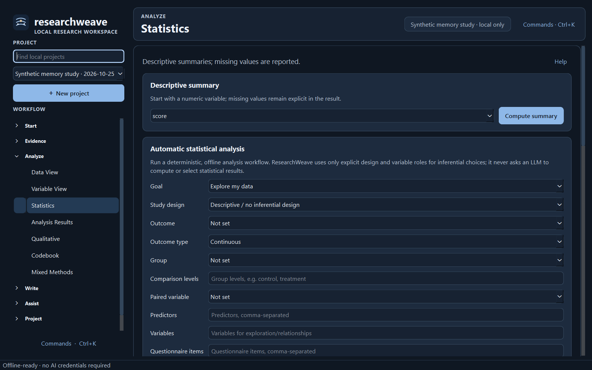
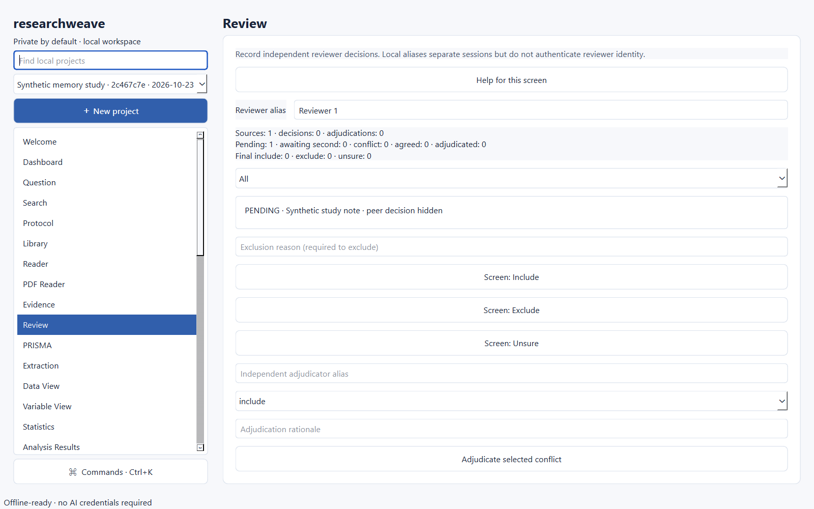
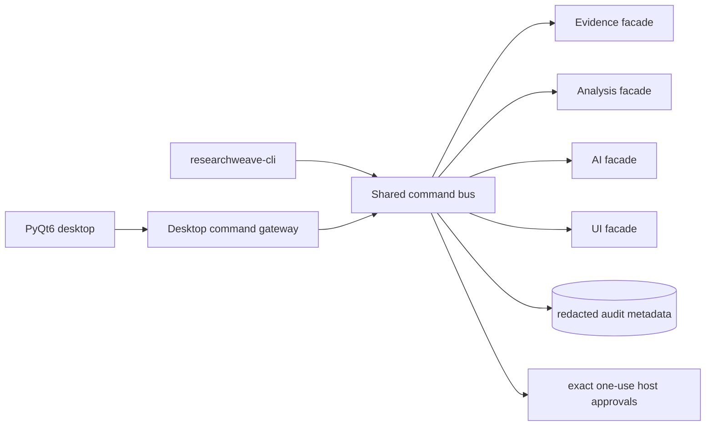

# ResearchWeave

**A local-first PyQt6 research workspace for evidence, analysis, reproducibility, and controlled AI assistance.**

 

ResearchWeave runs without an account, API key, model download, or network connection for its core desktop workflow. The integrated V2 application combines research/evidence management, quantitative and qualitative analysis, local provenance, optional AI tooling, and an accessible desktop UI behind a shared typed command bus and host-approval boundary.


The screenshot above is captured from the running integrated application on Windows using `scripts/capture_screenshots.py`. It contains only deterministic synthetic data. Dark-theme and workflow screenshots are stored under [`assets/screenshots`](assets/screenshots/).

## What works locally

The current integrated application has locally observed Windows verification for:

- project creation, reopening, local backups/recovery, protocol and research-question workflows;
- source/evidence capture, screening, PRISMA state, extraction, citation-oriented writing and migration helpers;
- CSV/TSV plus optional XLSX/ODS/Parquet/SPSS/Stata import paths, dataset revisions, missing-data workflows and reproducible transformations;
- descriptive/inferential statistics, regression families, psychometrics, meta-analysis, survival/time-series methods, qualitative coding, mixed methods and plot exports;
- local retrieval, privacy classification, durable AI-agent planning and controlled provider/sync adapters behind explicit policy gates;
- light/dark/contrast themes, keyboard navigation, accessibility metadata, recovery, jobs, notifications and large-table paging;
- a self-contained Windows PyInstaller bundle that starts without a Python interpreter installed by the user.

The desktop shell groups work by research phase instead of presenting one long flat menu. A persistent page header shows the active workspace and local project context; project search stays in the sidebar; common actions are kept close to the current task; and `Ctrl+K` remains available as a command palette for experienced users. Theme tokens include explicit focus states and measured text contrast, including primary-button and selected-text contrast.

Some capabilities remain conditional. Remote AI providers, remote encrypted sync and external catalog lookups require explicit host configuration and user authorization. The desktop currently exposes AI/provider state and proposal workflows, while several advanced AI facade operations are verified through the shared backend command bus but are not yet fully surfaced as end-user desktop actions. Linux/macOS build workflows exist but have not been observed in this local Windows session.

## Five-minute local start

Developer setup requires [uv](https://docs.astral.sh/uv/) and Python 3.12:

```powershell
uv sync --locked --extra dev --extra formats
uv run researchweave
```

The desktop starts in offline mode. Create a project, add a local source or synthetic note, import a CSV in **Data View**, inspect variables, then open **Statistics** or **Analysis Results**. No AI setup is required.

For a headless health check:

```powershell
uv run researchweave-cli health
uv run researchweave-cli capabilities
```

## Actual application views

| Dashboard | Statistics | Review |
|---|---|---|
|  |  |  |

The screenshot manifest records SHA-256 hashes, theme, screen and capture mode: [`assets/screenshots/manifest.json`](assets/screenshots/manifest.json).

## Architecture



The shared request envelope binds operation, project, request ID, arguments, revision and actor. Non-read operations require an expiring one-use host approval. Analysis and AI retain their own domain-specific capability checks after the shared gate. The integration audit stores hashes and metadata rather than argument/result payloads.

## Scientific analysis

ResearchWeave records dataset revisions and method provenance rather than silently mutating analysis inputs. The integrated test suite includes deterministic and oracle-style checks for statistics, missing data, psychometrics, time-series, survival, meta-analysis, plotting and import/export behavior. Warnings and assumptions are kept with analysis results.

The desktop production-analysis bridge currently exposes production descriptive statistics from persisted UI datasets. The headless analysis facade exposes the larger V2 scientific operation catalog through the shared command bus.


## Systematic review and qualitative work

Evidence-domain operations cover protocols, study screening, extraction, PRISMA 2020 state, reference identity, synthesis and project portability. Qualitative analysis includes codebooks, annotations, coder disagreement support and mixed-method links. The Review view below is from the same deterministic local fixture.


## AI and privacy

AI is optional. Default `EgressPolicy` is offline, and provider/network operations require explicit configuration and authorization. Locally verified integration tests show that a restricted project is denied remote egress, local retrieval ingestion requires approval, and a durable agent plan can query verified local evidence through the common command bus.

Consumer chat subscriptions are not treated as API credentials. Provider adapters require supported provider endpoints or local runtimes. See [`docs/INTEGRATIONS.md`](docs/INTEGRATIONS.md) for verified support levels.

## Project portability and exports

The evidence subsystem implements `.rwproj`-oriented project/archive workflows, checksum validation, migration helpers and encrypted archive support using audited cryptographic primitives. Import/export fidelity varies by format; warnings and checksums are returned where implemented. Never treat conversion as proof that proprietary application semantics are perfectly preserved.

## Windows portable package

The locally observed build command is:

```powershell
powershell -ExecutionPolicy Bypass -File packaging\windows\build.ps1
powershell -ExecutionPolicy Bypass -File packaging\windows\smoke-portable.ps1
```

The smoke script extracts the ZIP into a fresh temporary directory, launches the packaged executable without invoking a Python interpreter, verifies it remains alive, removes the package, and confirms simulated user-profile data remains intact. The locally observed ZIP is not committed to Git.

Linux and macOS build scripts are included under [`packaging`](packaging/) and a GitHub Actions matrix is defined in [`.github/workflows/release-builds.yml`](.github/workflows/release-builds.yml). Those operating-system builds are **not locally verified in this Windows session**.

## Development checks

```powershell
uv run --extra dev --extra formats python scripts/tasks.py lint
uv run --extra dev --extra formats python scripts/tasks.py types
uv run --extra dev --extra formats python scripts/tasks.py test
uv run --extra dev --extra formats python scripts/tasks.py skills
uv run --extra dev --extra formats python scripts/tasks.py metrics
uv run --extra dev --extra formats python scripts/tasks.py readme
```

The latest observed integrated run completed **703 tests passed, 10 explicitly skipped, with 3 warnings**. The source metric report currently measures **48,643 substantive first-party Python SLOC across 152 source files** using AST/tokenize rules documented in [`docs/verification/CODE_METRICS.json`](docs/verification/CODE_METRICS.json). `cloc`/`tokei` were not installed in the observed environment, so no second counter is claimed.

## Security, dependencies and reproducibility

- CycloneDX SBOM: [`docs/verification/SBOM.cdx.json`](docs/verification/SBOM.cdx.json)
- dependency license inventory: [`docs/verification/DEPENDENCY_LICENSES.json`](docs/verification/DEPENDENCY_LICENSES.json)
- secret-scan output: [`docs/verification/SECRETS_SCAN.json`](docs/verification/SECRETS_SCAN.json)
- integration ledger: [`docs/verification/INTEGRATION_LEDGER.md`](docs/verification/INTEGRATION_LEDGER.md)
- threat model: [`docs/security/THREAT_MODEL.md`](docs/security/THREAT_MODEL.md)

`pip-audit --local` currently reports **no known vulnerabilities** in the installed environment. An
earlier scan found seven advisories in `cryptography 47.0.0`; the canonical constraint was upgraded to
`cryptography>=50,<51`, the lock resolved 50.0.2, focused cryptography/archive tests passed, and the
Windows portable bundle was rebuilt afterward. See [`docs/verification/PIP_AUDIT.json`](docs/verification/PIP_AUDIT.json).

## Support status

Support levels use five labels: **native verified**, **file import/export verified**, **limited/conditional**, **experimental**, and **not supported**. See [`docs/INTEGRATIONS.md`](docs/INTEGRATIONS.md) for details and caveats.

## Repository and release status

The integrated V2 baseline is now on the local `main` checkout. The current UI transformation and verification changes are reviewed locally before publication; this session does not push them automatically. Machine-local QA evidence, private prompts, caches, pre-integration recovery artifacts and disposable test workspaces are excluded from Git through explicit ignore rules. See the integration ledger for merge history and the verification documents for reproducible checks.

## Contributing

Read [`CONTRIBUTING.md`](CONTRIBUTING.md), [`SECURITY.md`](SECURITY.md), and [`AGENTS.md`](AGENTS.md). Do not commit credentials, unpublished/private research data, raw participant data or large model weights.

## License and citation

ResearchWeave source is GPL-3.0-only because the free PyQt6 binding is GPL-licensed. Bundled dependency licenses must be reviewed as part of every release build. See [`LICENSE`](LICENSE), [`docs/DEPENDENCY_LICENSES.md`](docs/DEPENDENCY_LICENSES.md), and [`CITATION.cff`](CITATION.cff).

ResearchWeave has no required hosted backend and no compulsory subscription. Optional provider/API usage may create user-borne costs depending on the selected service.
