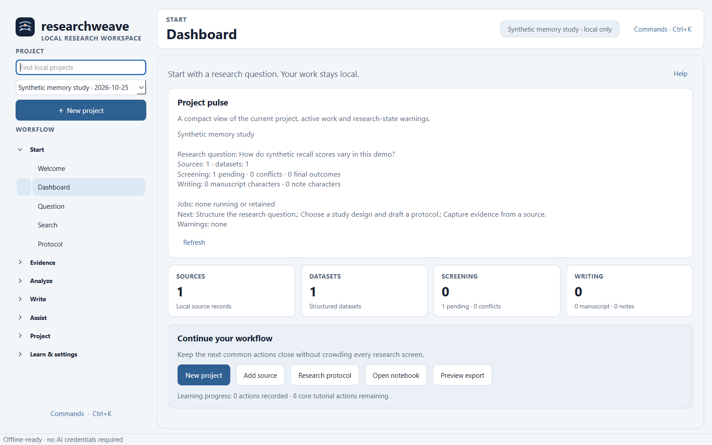
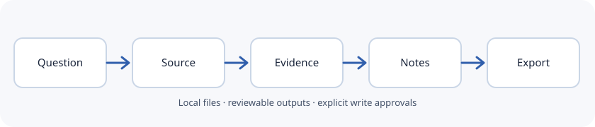
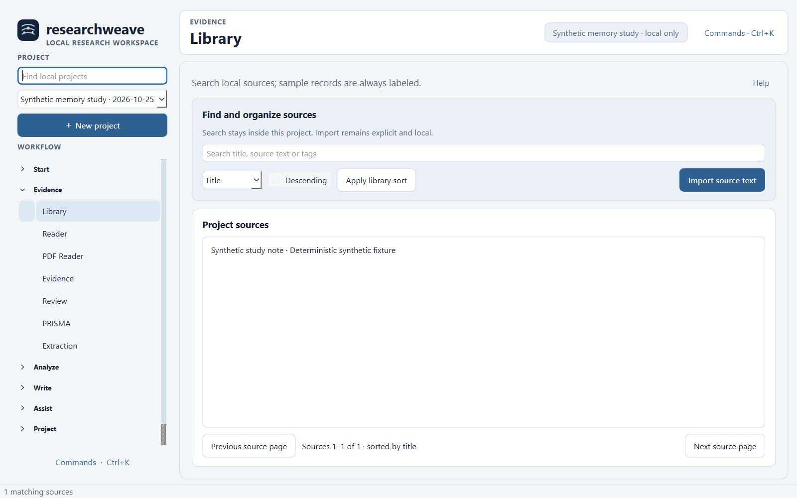
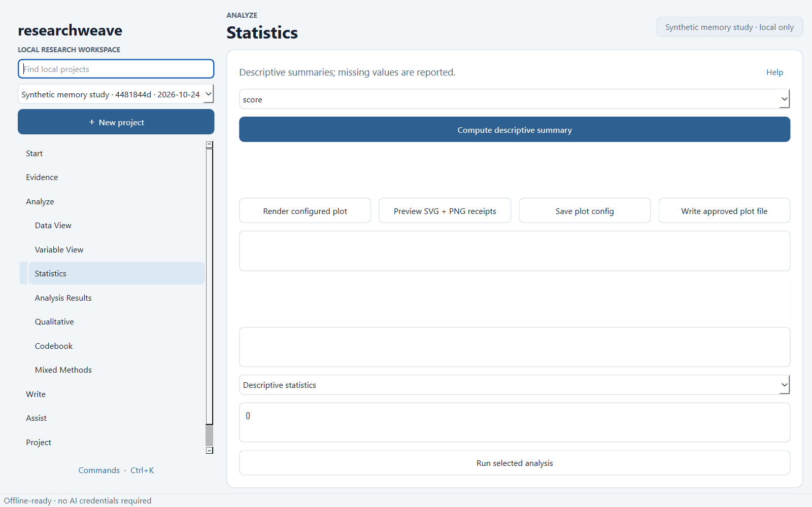
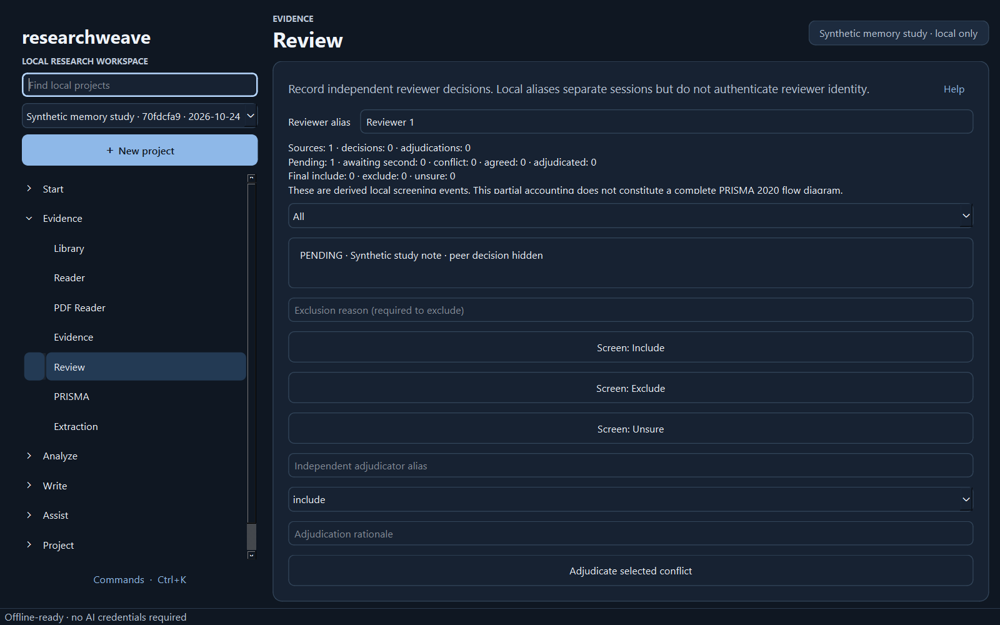
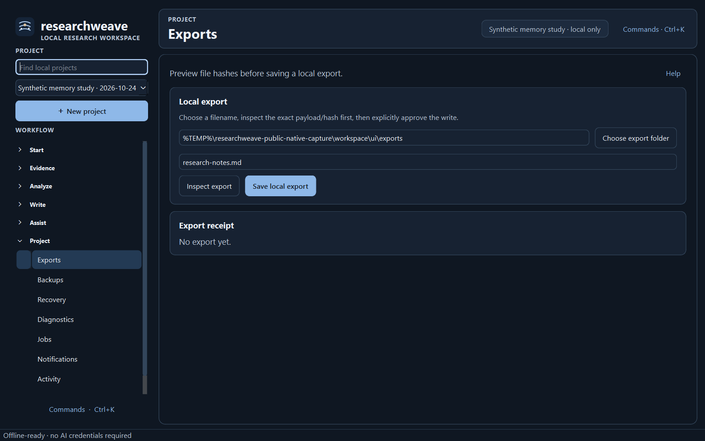
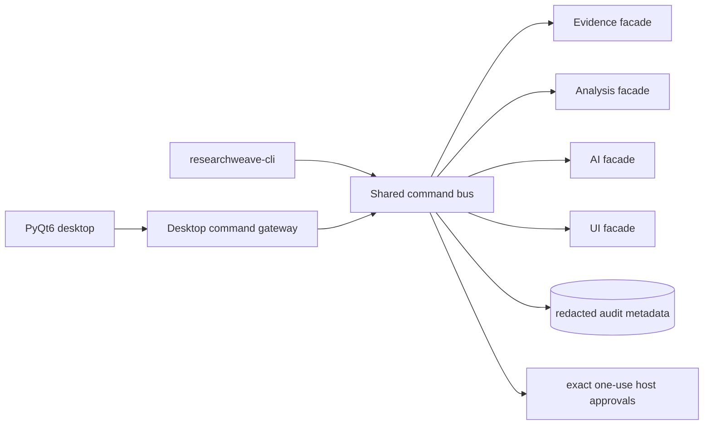

<p align="center">
  
</p>

# ResearchWeave

**A local-first PyQt6 research workspace for evidence, analysis, reproducibility, and controlled AI assistance.**

  

ResearchWeave runs without an account, API key, model download, or network connection for its core desktop workflow. The integrated V2 application combines research/evidence management, quantitative and qualitative analysis, local provenance, optional AI tooling, and an accessible desktop UI behind a shared typed command bus and host-approval boundary.



The screenshot above is captured from the running integrated application on Windows using `scripts/capture_screenshots.py`. It contains only deterministic synthetic data. The screenshot manifest records the screen, theme, byte size and SHA-256 for every capture.



## What works locally

The current integrated application has locally observed Windows verification for:

- project creation, reopening, local backups/recovery, protocol and research-question workflows;
- source/evidence capture, screening, PRISMA state, extraction, citation-oriented writing and migration helpers;
- CSV/TSV plus optional XLSX/ODS/Parquet/SPSS/Stata import paths, dataset revisions, missing-data workflows and reproducible transformations;
- descriptive/inferential statistics, regression families, psychometrics, meta-analysis, survival/time-series methods, qualitative coding, mixed methods and plot exports;
- local retrieval, privacy classification, durable AI-agent planning and controlled provider/sync adapters behind explicit policy gates;
- light/dark/contrast themes, keyboard navigation, accessibility metadata, recovery, jobs, notifications and large-table paging;
- a self-contained Windows PyInstaller bundle that starts without a Python interpreter installed by the user.

The desktop shell groups work by research phase instead of presenting one long flat menu. Only the active phase stays expanded, which keeps later workflows reachable on ordinary laptop screens. A persistent page header shows the active workspace and local project/privacy context; project search stays in the sidebar; common actions are kept close to the current task; and `Ctrl+K` remains available as a command palette for experienced users.

Dense workspaces use scrollable canvases rather than clipping controls. Dashboard, Library, Data View, Statistics, Review, Question and Exports use task-level surfaces so controls are grouped by intent instead of appearing as one long form. Review separates session setup, blinded screening and conflict adjudication; Dashboard surfaces project metrics and next actions; Library separates source discovery from the source list; Exports separates preview/write controls from the resulting receipt. Light, dark and high-contrast themes retain visible keyboard focus and measured text/selection contrast.

Some capabilities remain conditional. Remote AI providers, remote encrypted sync and external catalog lookups require explicit host configuration and user authorization. The existing **Providers** page now configures the real secret-free model runtime, and the existing **Agent** page embeds a project-scoped assistant with durable history, real streaming, tool activity, and exact approval/deny controls for non-read tool requests. Advanced headless AI operations that do not remove desktop workflow friction remain intentionally unsurfaced. Linux/macOS build workflows exist but have not been observed in this local Windows session.

## Five-minute local start

Developer setup requires [uv](https://docs.astral.sh/uv/) and Python 3.12:

```powershell
uv sync --locked --extra dev --extra formats
uv run researchweave
```

The desktop starts in offline mode. Create a project, add a local source or synthetic note, import a CSV in **Data View**, inspect variables, then open **Statistics** or **Analysis Results**. No AI setup is required.

For a headless health check:

```powershell
uv run researchweave-cli health
uv run researchweave-cli capabilities
```

## Actual application views

These images come from the integrated Qt application with the same deterministic synthetic project. The capture workspace is disposable and visible paths abbreviate private OS account prefixes.

| Dashboard | Library | Statistics |
|---|---|---|
|  |  |  |

| Review | Exports |
|---|---|
|  |  |

The complete 10-image light/dark screenshot set and SHA-256 manifest are under [`assets/screenshots`](assets/screenshots/); the machine-readable manifest is [`assets/screenshots/manifest.json`](assets/screenshots/manifest.json).

## Architecture



The shared request envelope binds operation, project, request ID, arguments, revision and actor. Non-read operations require an expiring one-use host approval. Analysis and AI retain their own domain-specific capability checks after the shared gate. The integration audit stores hashes and metadata rather than argument/result payloads.

## Scientific analysis

ResearchWeave records dataset revisions and method provenance rather than silently mutating analysis inputs. The integrated test suite includes deterministic and oracle-style checks for statistics, missing data, psychometrics, time-series, survival, meta-analysis, plotting and import/export behavior. Warnings and assumptions are kept with analysis results.

The desktop production-analysis bridge currently exposes production descriptive statistics from persisted UI datasets. The headless analysis facade exposes the larger V2 scientific operation catalog through the shared command bus.


## Systematic review and qualitative work

Evidence-domain operations cover protocols, study screening, extraction, PRISMA 2020 state, reference identity, synthesis and project portability. Qualitative analysis includes codebooks, annotations, coder disagreement support and mixed-method links. The Review view below is from the same deterministic local fixture.


## AI and privacy

AI is optional. Default `EgressPolicy` is offline, and provider/network operations require explicit configuration and authorization. Model profiles store endpoint/model metadata and only the **name** of an external credential environment variable, never its secret value. Local OpenAI-compatible endpoints can be used while desktop offline mode remains enabled; hosted endpoints require offline mode to be disabled, explicit egress acknowledgement, and a host allowlist derived from the selected endpoint. Native Windows QA also verified streamed assistant output against a deterministic loopback OpenAI-compatible fixture, restart-persistent conversation history, safe failure for an unavailable loopback endpoint, and manual-mode fallback without any API key or model download.

Consumer chat subscriptions are not treated as API credentials. Provider adapters require supported provider endpoints or local runtimes. See [`docs/INTEGRATIONS.md`](docs/INTEGRATIONS.md) for verified support levels.

## Project portability and exports

The evidence subsystem implements `.rwproj`-oriented project/archive workflows, checksum validation, migration helpers and encrypted archive support using audited cryptographic primitives. Import/export fidelity varies by format; warnings and checksums are returned where implemented. Never treat conversion as proof that proprietary application semantics are perfectly preserved.

## Windows portable package

The locally observed build command is:

```powershell
powershell -ExecutionPolicy Bypass -File packaging\windows\build.ps1
powershell -ExecutionPolicy Bypass -File packaging\windows\smoke-portable.ps1
```

The smoke script extracts the ZIP into a fresh temporary directory, launches the packaged executable without invoking a Python interpreter, verifies it remains alive, removes the package, and confirms simulated user-profile data remains intact. The locally observed ZIP is not committed to Git.

The Windows executable uses the original ResearchWeave mark as its application icon. `scripts/generate_brand_icon.py` renders the reviewed SVG into release PNG/ICO assets, while the PyInstaller spec bundles the runtime SVG assets used by the desktop shell.

Linux and macOS build scripts are included under [`packaging`](packaging/) and the native release matrix is defined in [`.github/workflows/release.yml`](.github/workflows/release.yml). Windows packaging is locally verified in this Windows session; macOS and Linux artifacts are verified on their native GitHub-hosted runners before release publication.

Maintainer build and release procedures are documented in [`docs/BUILDING.md`](docs/BUILDING.md) and [`docs/RELEASING.md`](docs/RELEASING.md).

## Development checks

```powershell
uv run --extra dev --extra formats python scripts/tasks.py lint
uv run --extra dev --extra formats python scripts/tasks.py types
uv run --extra dev --extra formats python scripts/tasks.py test
uv run --extra dev --extra formats python scripts/tasks.py skills
uv run --extra dev --extra formats python scripts/tasks.py metrics
uv run --extra dev --extra formats python scripts/tasks.py readme
```

Native screenshot evidence can be regenerated with:

```powershell
uv run --extra dev python scripts/capture_screenshots.py
```

The latest observed integrated run completed **729 tests passed, 10 explicitly skipped, with 3 warnings** and **84% total coverage**. The source metric report currently measures **51,222 substantive first-party Python SLOC across 156 source files** using AST/tokenize rules documented in [`docs/verification/CODE_METRICS.json`](docs/verification/CODE_METRICS.json). `cloc`/`tokei` were not installed in the observed environment, so no second counter is claimed.

## Security, dependencies and reproducibility

- CycloneDX SBOM: [`docs/verification/SBOM.cdx.json`](docs/verification/SBOM.cdx.json)
- dependency license inventory: [`docs/verification/DEPENDENCY_LICENSES.json`](docs/verification/DEPENDENCY_LICENSES.json)
- secret-scan output: [`docs/verification/SECRETS_SCAN.json`](docs/verification/SECRETS_SCAN.json)
- integration ledger: [`docs/verification/INTEGRATION_LEDGER.md`](docs/verification/INTEGRATION_LEDGER.md)
- threat model: [`docs/security/THREAT_MODEL.md`](docs/security/THREAT_MODEL.md)

`pip-audit --local` currently reports **no known vulnerabilities** in the installed environment. An
earlier scan found seven advisories in `cryptography 47.0.0`; the canonical constraint was upgraded to
`cryptography>=50,<51`, the lock resolved 50.0.2, focused cryptography/archive tests passed, and the
Windows portable bundle was rebuilt afterward. See [`docs/verification/PIP_AUDIT.json`](docs/verification/PIP_AUDIT.json).

## Support status

Support levels use five labels: **native verified**, **file import/export verified**, **limited/conditional**, **experimental**, and **not supported**. See [`docs/INTEGRATIONS.md`](docs/INTEGRATIONS.md) for details and caveats.

## Repository and release status

The integrated V2 baseline is now on the local `main` checkout. The current UI transformation and verification changes are reviewed locally before publication; this session does not push them automatically. Machine-local QA evidence, private prompts, caches, pre-integration recovery artifacts and disposable test workspaces are excluded from Git through explicit ignore rules. See the integration ledger for merge history and the verification documents for reproducible checks.

## Contributing

Read [`CONTRIBUTING.md`](CONTRIBUTING.md), [`SECURITY.md`](SECURITY.md), and [`AGENTS.md`](AGENTS.md). Do not commit credentials, unpublished/private research data, raw participant data or large model weights.

## License and citation

ResearchWeave source is GPL-3.0-only because the free PyQt6 binding is GPL-licensed. Bundled dependency licenses must be reviewed as part of every release build. See [`LICENSE`](LICENSE), [`docs/DEPENDENCY_LICENSES.md`](docs/DEPENDENCY_LICENSES.md), and [`CITATION.cff`](CITATION.cff).

ResearchWeave has no required hosted backend and no compulsory subscription. Optional provider/API usage may create user-borne costs depending on the selected service.
