<p align="center">
  
</p>

<h1 align="center">ResearchWeave</h1>

<p align="center">
  <strong>Your research, in one local Rust workspace.</strong><br/>
  Organize sources, analyze data, write with traceable revisions, and keep control of your files and AI actions.
</p>

<p align="center">
  
  
  
  <a href="LICENSE"></a>
</p>

<p align="center">
  <a href="https://github.com/aradmanamnaoon/researchweave/actions/workflows/quality.yml"></a>
  <a href="https://github.com/aradmanamnaoon/researchweave/actions/workflows/rust-release-candidate.yml"></a>
  <a href="https://github.com/aradmanamnaoon/researchweave/releases"></a>
</p>

<p align="center">
  <a href="#downloads-and-release-status">Download</a> ·
  <a href="#start-with-one-research-workflow">First workflow</a> ·
  <a href="#real-rust-desktop">Screenshots</a> ·
  <a href="#capability-status-at-a-glance">Feature status</a> ·
  <a href="#quick-start">Quick start</a> ·
  <a href="#architecture">Architecture</a> ·
  <a href="#build-from-source">Build</a> ·
  <a href="#verification-and-release-gates">Verification</a> ·
  <a href="#contributing">Contributing</a>
</p>

<p align="center">
  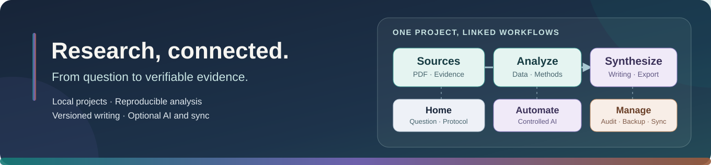
</p>

<p align="center">
  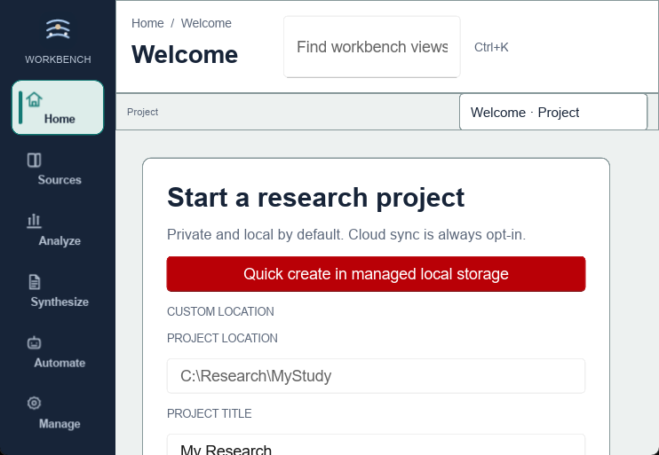
</p>

<p align="center"><em>The welcome screenshot is from a previously captured Rust desktop build. The banner above illustrates the research workflow; it is not an app screenshot or a preview of unfinished UX features.</em></p>

> [!IMPORTANT]
> **Published release: Rust v0.2.0.** The current UX redesign is under development; the screenshots and downloads below refer to the previously published build, not an unverified new release. ResearchWeave stores projects locally; no cloud storage account is needed. The [archived Python v0.1.2 release](https://github.com/aradmanamnaoon/researchweave/releases/tag/v0.1.2) and Python-to-Rust compatibility fixtures remain available for historical recovery.

> **Unreleased UX candidate (29 October 2026):** Sources now has working Rust-backed **Search (route 3)** and **Reader (route 6)** screens for project-local stored text. A newer private Linux/Xvfb navigation audit passed **40/40 routes**, with **eight remaining placeholder destinations**. The tested executable SHA-256 was `77295db0109768f108495a31d932238431aeb0a86988325a63dd4258318023c7`; `source_changed_during_audit=false`. A separate **real private Linux synthetic Search → Reader GUI test passed** on that executable, with exact 207-character Unicode text and six hashed captures. This does not establish larger-text pagination or other OSes. This candidate is not the published v0.2.0 installer. [Detailed source/QA boundaries](docs/ux/CROSS_PLATFORM_QA.md).

## Downloads and release status

**Current published Rust build:** [ResearchWeave v0.2.0](https://github.com/aradmanamnaoon/researchweave/releases/tag/v0.2.0). The [latest release page](https://github.com/aradmanamnaoon/researchweave/releases/latest) shows the currently designated version; confirm its files and checksums before installation.

**Rust v0.2.0 download options** (these URLs deliberately remain on the existing published release until the next release's native tests and public-file verification have succeeded):

| Platform | Native Rust artifact | Verification required | Public Rust download |
| --- | --- | --- | --- |
| Windows x64 | Native installer (`.exe`) | Installed-package launch and Windows UI Automation | [v0.2.0 Windows x64](https://github.com/aradmanamnaoon/researchweave/releases/download/v0.2.0/ResearchWeave-v0.2.0-windows-x64-setup.exe) |
| macOS Apple Silicon | `.app` inside `.dmg` | Mounted-app launch and relaunch on ARM64 | [v0.2.0 macOS arm64](https://github.com/aradmanamnaoon/researchweave/releases/download/v0.2.0/ResearchWeave-v0.2.0-macos-arm64.dmg) |
| macOS Intel | `.app` inside `.dmg` | Mounted-app launch and relaunch on x64 | [v0.2.0 macOS x64](https://github.com/aradmanamnaoon/researchweave/releases/download/v0.2.0/ResearchWeave-v0.2.0-macos-x64.dmg) |
| Linux x86_64 | AppImage + Debian package | Installed-package launch and AT-SPI accessibility | [v0.2.0 AppImage](https://github.com/aradmanamnaoon/researchweave/releases/download/v0.2.0/ResearchWeave-v0.2.0-linux-x86_64.AppImage) · [v0.2.0 DEB](https://github.com/aradmanamnaoon/researchweave/releases/download/v0.2.0/ResearchWeave-v0.2.0-linux-amd64.deb) |

Checksum manifest: [v0.2.0 SHA256SUMS.txt](https://github.com/aradmanamnaoon/researchweave/releases/download/v0.2.0/SHA256SUMS.txt). For each downloaded file, compare the published SHA-256 digest to the local artifact. Packages from the new UX branch must receive a **new** exact-commit verification before their links replace these.

## Quick start

**Installing ResearchWeave?** Start with the [published v0.2.0 release](https://github.com/aradmanamnaoon/researchweave/releases/tag/v0.2.0). To build the Rust desktop from source, install [Rustup](https://rustup.rs/) and your OS's native build tools. The published Rust source lives on [`main`](https://github.com/aradmanamnaoon/researchweave/tree/main):

```sh
git clone https://github.com/aradmanamnaoon/researchweave.git
cd researchweave
git switch main
rustup toolchain install 1.94.1
cargo +1.94.1 run --locked -p researchweave-desktop
```

The native PDF reader additionally needs the matching platform PDFium library; see [build instructions](#build-from-source). Project work starts locally without a cloud account or configured AI provider. Begin with a managed project in **Home**; from there you can register references, open local PDFs, import data, record analyses and edit manuscript sections. Some links between these workflows still require manually entering IDs or paths.

| Start here | Then try | Where to look |
| --- | --- | --- |
| **Create a local research project** | Add a question, protocol and source records | **Home → Sources** |
| **Import and inspect a dataset** | Run a descriptive or regression analysis with provenance | **Analyze → Statistics** |
| **Write and review a manuscript** | Save revisions and generate a DOCX export | **Synthesize → Manuscript** |

Research projects and encrypted portable archives work entirely offline. The current desktop's provider management is an **offline configuration flow**, not proof that a remote AI chat request is working.

## Start with one research workflow

Pick a single outcome and follow the workspace rather than learning every tool first:

| Step | In the desktop | What you get | Current limitation |
|:---:|---|---|---|
| **01** | **Home → Start Center** | A local project with an auditable revision history | Recent-project selection is limited; custom paths are manual |
| **02** | **Home → Research Question / Protocol** | A versioned question and protocol with preview-before-save | You may need to enter object IDs between screens |
| **03** | **Sources → Library / Search / Reader / PDF Reader** | Local source records; unreleased branch adds literal stored-text search, source list and paged verified text reading; PDF page viewing/search remains separate | Short Unicode Search → Reader GUI test passed on Linux Xvfb; long pagination, source-linked Evidence and PDF selection/annotation remain incomplete |
| **04** | **Analyze → Data / Statistics** | Imported dataset revisions and reproducible basic statistical results | Advanced analysis methods are richer in Rust libraries than in the desktop UI |
| **05** | **Synthesize → Manuscript** | Versioned section text and prepared DOCX/HTML/Markdown/PDF export | This is currently a structured text editor, not a Word-style page editor |
| **06** | **Manage → Backups / Recovery** | An optional encrypted local archive and restore-as-copy | Archive paths are currently entered manually |

<p align="center">
  
</p>

**New to research?** A *revision* is a saved version of a project object or dataset. A *preview* shows the proposed change before it is recorded. A *provenance record* explains which inputs and operations produced a result.

## What ResearchWeave is

ResearchWeave is designed as a **research workbench rather than a collection of disconnected utilities**. A project carries its evidence, source identities, revision history, datasets, analysis provenance, qualitative coding, manuscript state, audit trail, and optional AI context through a shared typed command boundary.

| Principle | What it means in the product |
| --- | --- |
| 🏠 **Local-first** | Core project work does not require an account, hosted backend, or AI provider. |
| 🧬 **Typed research records** | Sources, references, review records, extraction, datasets, codebooks and writing have project-scoped identities. Some relationships are present in Rust storage but not yet surfaced as direct UI navigation. |
| 🔬 **Scientific traceability** | Immutable dataset revisions, hashes, assumptions, complete-case accounting, bounded algorithms, and deterministic tests are first-class concerns. |
| 🤖 **AI with boundaries** | Local assistant conversations, retrieval proposals and approval-bound tool actions exist. The unreleased UX branch adds optional context previews and explicit local-model requests from research screens; selection grounding and hosted-provider consent UX are still pending. |
| 🔐 **Privacy by architecture** | Private text and credentials are not dumped into audit logs or AI provider profile metadata. Project data stays local; encrypted project archives are optional. |
| ⚡ **Native desktop** | The application runtime is Rust. Python is not hidden inside the shipped desktop app; Python helpers are limited to build/verification tooling where used. |

## The research workbench

The Rust UI uses six persistent activity roots. Each has its own original icon and keeps the application navigable even as specialized research screens grow.

| Activity | Visual | Research responsibility |
| --- | :---: | --- |
| **Home** |  | Start Center, project home, research question, protocol and project context |
| **Sources** |  | Library, references, native PDF page reading, review and extraction forms; the evidence reader remains incomplete |
| **Analyze** |  | Data import, immutable datasets, five basic statistics forms, qualitative coding and mixed methods; additional analysis kernels are accessible through Rust |
| **Synthesize** |  | Versioned plain-text notebook/manuscript, local exports, bibliography and publishing readiness checks |
| **Automate** |  | Assistant conversations, retrieval, agent proposals and controlled tool execution |
| **Manage** |  | AI provider configuration, diagnostics, activity history, local backups, recovery and preferences |

The shell also provides a global `Ctrl+K` command path, persistent status context, Jobs/Notifications surfaces, responsive collapse behavior, dark/light/high-contrast modes, compact density, reduced motion, and 80–200% application text scaling.

## Real Rust desktop

### Unreleased UX worktree — actual isolated Linux GUI captures

These screenshots were captured by launching the native Rust/Slint executable in a private Linux virtual display and clicking through it with desktop automation. They depict the **working UX branch**, not the published v0.2.0 installers. A real temporary SQLite project was used to test note creation, editing, autosave, pinning, archiving, trash, restoration and retained history. The manuscript screenshot demonstrates a larger writing canvas, not Word-equivalent rich editing.

| Project quick notes | Expanded manuscript writing |
| --- | --- |
| 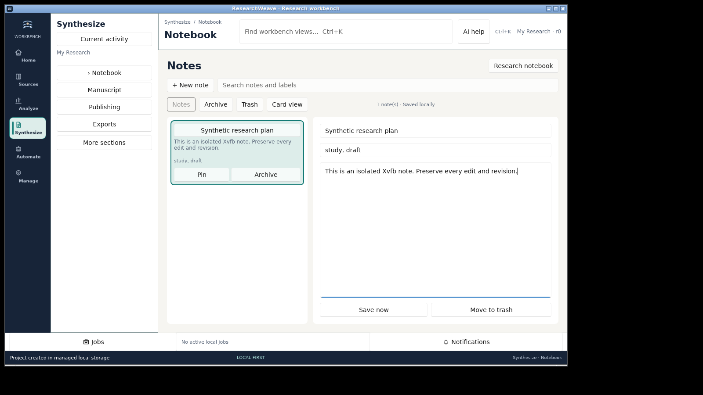 | 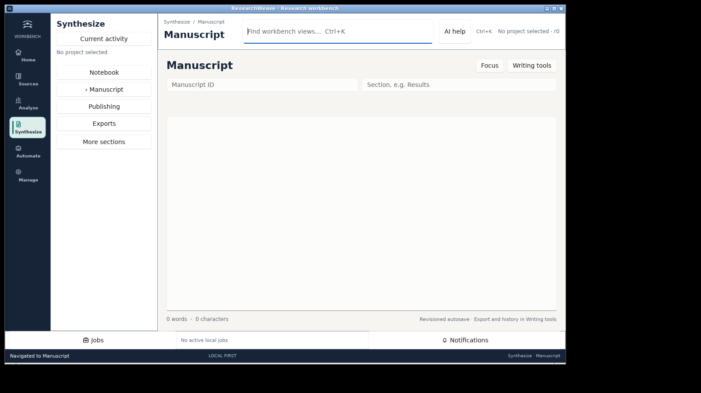 |

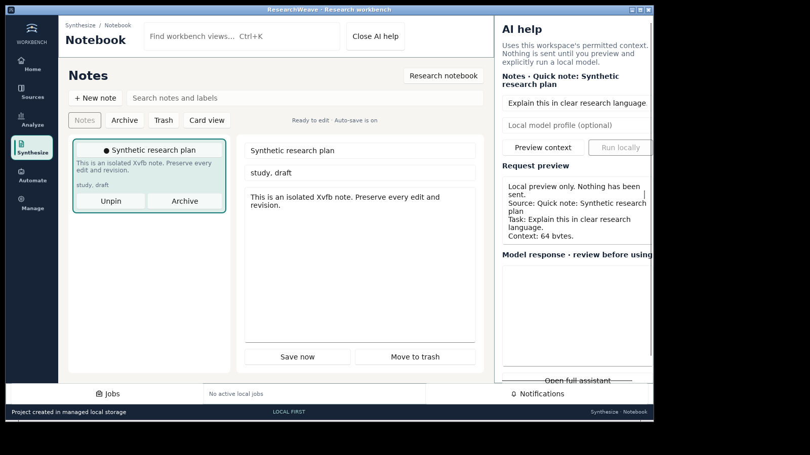

The AI panel previews bounded, user-reviewed context and requires an explicitly configured local model before inference. It does not silently transmit research content or replace manuscripts. The [100-skill source audit](docs/ux/100_SKILLS_APPLICATION_MATRIX.md), [screen inventory](docs/ux/SCREEN_INVENTORY.md) and [long-form persistence measurements](docs/ux/LONG_FORM_EDITOR.md) distinguish tested behavior from unfinished work.

### Newer unreleased source Search / Reader — actual private Linux GUI

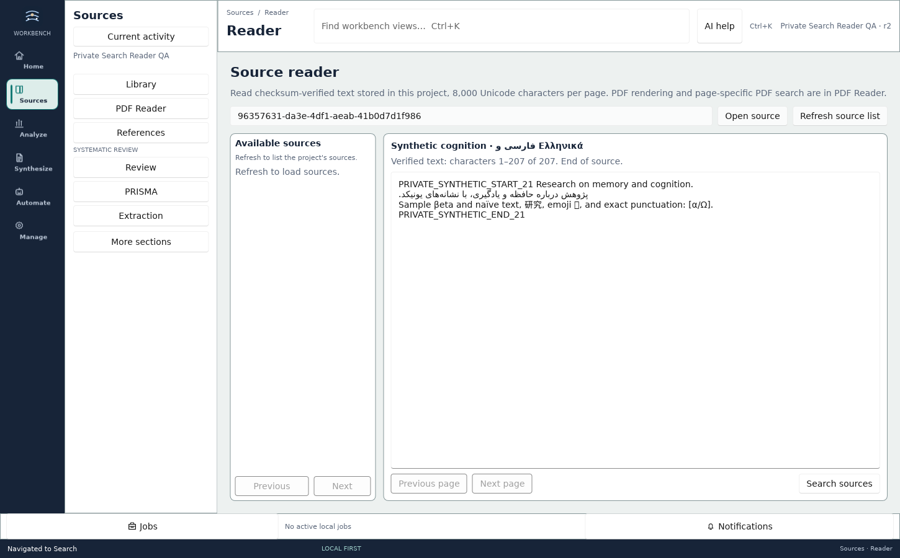

This **actual native Rust/Slint screenshot** is from a later synthetic Search → Reader GUI test on executable SHA-256 `77295db0109768f108495a31d932238431aeb0a86988325a63dd4258318023c7`. The scoped harness passed text equality, empty/no-result search feedback, invalid IDs, source-list reopening and return navigation. The [test receipt](docs/ux/screenshots/search-reader-xvfb/results.json) and [cross-platform QA report](docs/ux/CROSS_PLATFORM_QA.md) record provenance and exclusions. **It does not represent the published v0.2.0 release or prove long pagination, PDF selection, assistive technology, or macOS/Windows operation.**

### Previously published Rust interface

The images below were captured from **earlier running Rust/Slint builds** and are retained as historical UI examples. They are not mockups or Python/PyQt screenshots, and they do not demonstrate completion or visual QA of the ongoing UX transformation.

| Manuscript + DOCX | Native PDF reader |
| --- | --- |
| 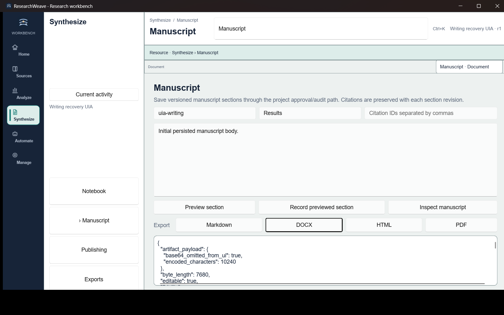 | 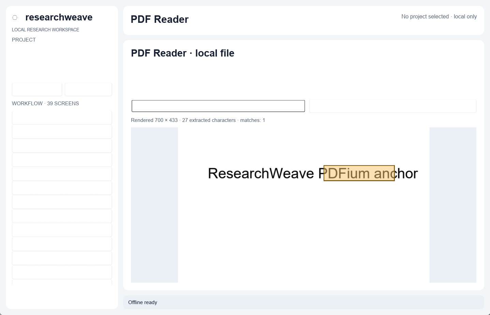 |

| Project home | Activity rail / start center |
| --- | --- |
| 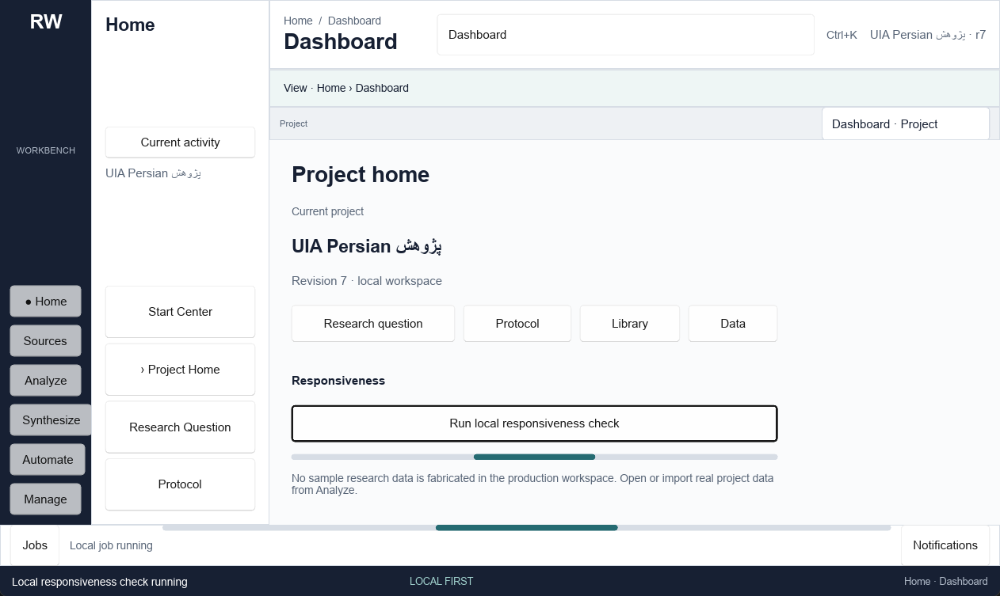 |  |

The current design system uses **Deep Ink** (`#172438`), **Research Teal** (`#147A75`), **Evidence Violet** (`#7564B5`), **Discovery Copper** (`#9A5B3A`) and **Soft Paper** (`#F6F5F1`). High-contrast mode replaces those semantic roles with non-color-dependent selection/focus cues. See [`docs/design/RESEARCHWEAVE_DESIGN_SYSTEM.md`](docs/design/RESEARCHWEAVE_DESIGN_SYSTEM.md).

## What ResearchWeave does

The current Rust workspace is split into nine focused crates and exposes project-scoped capabilities through the shared command router. The high-level product surface is summarized below; detailed implementation status lives in [`docs/verification/FEATURE_EXPANSION.md`](docs/verification/FEATURE_EXPANSION.md).

## Capability status at a glance

The **Rust domain library**, **desktop screen** and **release evidence** have different levels of completion. This is a source-based inventory of the existing UI; each claim still needs a fresh acceptance run when the UX branch changes.

| Area | Working in the current Rust desktop | Present in Rust or partially wired | Not yet available as the requested UX |
|---|---|---|---|
| **Projects and local safety** | Managed create/open, metadata preview/record, archives and recovery | Audit/activity, diagnostics, project migration | Recent-project dashboard, complete guided recovery |
| **Sources and reviews** | Local source entry, references, PDF page search, review votes, PRISMA text counts, extraction JSON forms; **unreleased UX branch:** local source Search and paged Reader backed by `search.query` and `source.full_text` | Anchors, source relationships, review algorithms | Longer Reader pagination, visual evidence anchoring, cross-OS Search/Reader and screening queue |
| **Data and methods** | Import/inspect datasets, variable metadata, descriptives, frequency, Pearson, Welch t, HC3 OLS; **unreleased UX branch:** read-only `StandardTableView` with 25-row paging controls | Additional statistical methods, plots and reproducible results in Rust crates | Editable spreadsheet features and visual interactive analysis across every method; multi-page and cross-OS grid acceptance pending |
| **Qualitative and mixed methods** | Codebook/annotation/mapping forms, kappa, verified joint-display action | Project-scoped coder state and quality/provenance checks | Visual transcript coding and rich joint-display table |
| **Notes and writing** | Project notebook editor; versioned manuscript sections, recovery and DOCX/HTML/PDF/Markdown exports | Unreleased UX branch has quick-note cards/list, pin/archive/trash/restore, labels/search and durable drafts | Word-style rich, paginated editing and complete citations-in-context |
| **Assistant and automation** | Local conversation/template forms, offline provider profiles, human-reviewed retrieval tool proposals | Unreleased UX branch has optional contextual AI preview and explicit local-model generation | Selection-grounded editing, end-to-end streaming chat and consented hosted-provider UX |
| **Display and accessibility** | Six navigation roots, Ctrl+K, display themes, density, scale and basic keyboard semantics | Windows UIA scripts and native OS accessibility probes | Complete NVDA/VoiceOver/Orca, real RTL IME and all-state visual QA |

**Reading this table:** “Working” means the current Slint screen has a concrete handler, not that every variation passed a new user study. “Present in Rust” describes implementation or infrastructure without promising a mature, clickable desktop workflow. Historical screenshots and test reports are not proof for unreviewed UX branch changes.

**Current local QA boundary:** The newer 40-route private native Linux audit passed on the exact executable hash recorded above, with eight placeholders: **Evidence (8), Privacy (25), Integrations (26), Exports (27), Tutorials (33), Guidance (34), Shortcuts (35), About (38)**. Source Search/Reader backend tests and desktop compilation passed. A separate private Linux/Xvfb Search → Reader GUI harness passed source creation, empty/no-match queries, one Unicode match, exact 207-character Reader text, invalid/empty IDs and return navigation; the evidence is in the private WSL directory `/home/saba/researchweave-gui-audits/search-reader-worker1-r4/` (six hashed screenshots). Fresh isolated Xvfb runs also passed the synthetic 15-page Unicode manuscript round-trip, populated Data View grid and found-text contextual AI preview scenarios. **Longer Reader pagination, human screen-reader and Windows/macOS package behavior remain untested.** Windows workspace tests were reported **188 passing**, with formatting and strict Clippy passing, but a single frozen-commit cross-platform installed-package matrix remains outstanding.

See [the route-by-route screen inventory](docs/ux/SCREEN_INVENTORY.md), [workflow handoff audit](docs/ux/WORKFLOW_INVENTORY.md) and [contextual AI audit](docs/ux/AI_INTEGRATION_AUDIT.md) for the dated pre-transformation baseline.

### Projects, integrity and recovery

- versioned local project schema with migrations;
- revision/CAS checks for project mutations;
- chained event history and payload hashing;
- structural diagnostics for event-chain, object, body-hash and annotation integrity;
- payload-free project activity history with exact-operation filtering;
- local recovery snapshots/journals and portable project/archive workflows;
- encrypted archive support and bounded recovery flows;
- writing crash journal with atomic Windows replacement and automatic retry after abrupt exit.

### Sources, references and evidence

- local UTF-8 source storage with content-addressed objects;
- reference creation/import/export and bibliography preview;
- citation links, revocation, citation graph and GraphML export;
- native PDFium rendering/text mapping and persisted highlight/relocation infrastructure;
- question and protocol version history;
- review records, blinded screening state, adjudication/extraction infrastructure and derived PRISMA accounting;
- versioned typed extraction forms and persisted validated values;
- qualitative codebooks and character-offset annotations bound to verified source text.

### Data and quantitative analysis

Native data ingestion currently includes:

| Family | Supported Rust paths |
| --- | --- |
| Delimited | CSV, TSV |
| Spreadsheet | XLSX, ODS |
| Columnar | Parquet |
| Statistical packages | SPSS SAV/ZSAV, Stata DTA |

Imported datasets are stored as immutable revisions with a stable dataset identity and source hash. Analysis paths preserve revision/hash provenance rather than silently mutating a dataset in place.

Implemented statistical breadth includes descriptive/frequency analysis, correlations, hypothesis tests, multiple-testing adjustment, regression/GLM families, logistic and Poisson models, survival/log-rank, meta-analysis, psychometrics/reliability and scale scoring, power/sample-size routines, PCA, seeded k-means, deterministic hierarchical clustering, survey estimates, DID, GEE, time-series features, missingness/imputation workflows and deterministic SVG/PNG plots. Individual methods still have their own assumptions, resource bounds and validation limits; “implemented” is not a claim of universal statistical suitability.

The current native Statistics workbench uses progressive disclosure rather than a single expert-option wall. Windows UI Automation exercises descriptives, categorical frequency tables, Pearson correlation, explicit two-group Welch t tests and HC3-robust OLS against immutable dataset revisions. Human-readable summaries show key estimates/sample counts/provenance first while the full verified result payload remains available for audit.

<p align="center">
  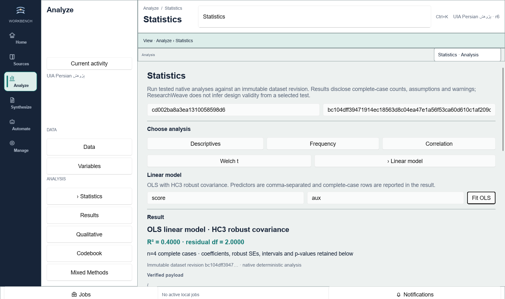
</p>

### Qualitative and mixed methods

Qualitative state is stored inside the project rather than as loose UI state. Codebook mutations are optimistic-concurrency guarded by the qualitative content hash, annotations verify source/body hashes and exact character spans, and coder-agreement helpers are explicit about fixed-unit assumptions.

The mixed-methods bridge now has a **trusted host composition path**: the desktop reloads persisted transcript→case mappings and the current verified coding snapshot itself, then joins them to an immutable quantitative dataset revision. The client is not allowed to inject its own coding hash, case map or excerpt payload. Current joint displays are descriptive and carry an explicit non-causal limitation.

### Systematic review workflow

ResearchWeave supports a persisted chain from reference identity to review record, blinded screening vote, typed extraction and derived PRISMA state. Windows UI Automation exercises that path through the real desktop. Broader multi-user ACL, reversible deduplication, full-text conflict/adjudication depth and review-specific AI evaluation remain active expansion work rather than silently claimed parity.

### Manuscript and publishing

The current native writing workflow includes:

- project-scoped notebook save/history/export;
- manuscript ID + section + citations + body revisions;
- synchronous crash journal plus debounced routed persistence;
- section history/restore and manuscript inspection;
- bibliography/readiness checks;
- Markdown, HTML, DOCX and PDF manuscript export;
- deterministic DOCX structure tests;
- draft submission ZIP generation including `manuscript.docx`, bibliography/manifest information, hashes and an explicit `submission_performed=false` receipt.

The editor is intentionally described as a **structured versioned manuscript editor**, not yet a Word-class page-layout engine. Track changes, comments, rich document trees, cross-references, footnotes/equations and journal-template fidelity remain product work.

## AI without silent autonomy

AI is optional. ResearchWeave keeps AI behind the same project/approval model instead of giving a model direct ambient write access.

Current Rust AI infrastructure includes provider metadata/profile management, local OpenAI-compatible and Ollama-oriented adapters, hosted-provider policy checks, durable project conversations, prompt templates, local lexical retrieval with source/revision provenance, retrieval source revocation, bounded agent plans and exact-fingerprint one-use approvals for actions.

Important boundaries:

- provider profiles are **secret-free metadata**; credentials are not returned in profile lists;
- credential-bearing endpoint URLs are rejected;
- offline/egress policy is checked before remote credential resolution;
- project/source text remains untrusted prompt content rather than trusted system instruction;
- agent plans are inert until explicitly approved;
- router audit stores operation metadata/hashes rather than private raw arguments;
- current retrieval is local lexical retrieval, not an exaggerated “semantic RAG” claim;
- provider list/configuration does not imply a live connectivity check unless one was explicitly performed.
- the published v0.2.0 desktop does not offer contextual assistant entry from every task screen; the UX worktree adds an optional panel with preview and explicit local-model execution, but configuring a provider does not itself execute a completion.

See [`docs/verification/AI_CAPABILITIES.md`](docs/verification/AI_CAPABILITIES.md) for the evidence-backed capability matrix and open evaluation work.

## Offline backups, encryption and portability

ResearchWeave stores research projects locally and provides portable project archives. Optional password-protected archives use authenticated encryption and verify project identity, revision and content integrity during recovery. Keep copies of your archives in a location you trust, and protect archive passwords: the app does not operate an online backup service.

## Research lifecycle

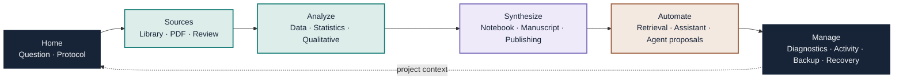

## Architecture

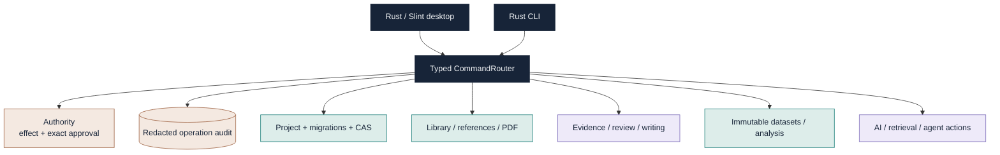

The command envelope binds operation, project, request identity, arguments, actor and revision context. Read operations can run without a write approval. Mutating/sensitive operations use effect-aware approval semantics; local writes remain revision-guarded where the domain contract requires it. Higher-level desktop composition routes can combine trusted domain reads without accepting provenance objects from untrusted caller arguments.

## Security and privacy model

ResearchWeave is not “secure because it is offline.” Security behavior is implemented as explicit boundaries:

- project mutations use revision/CAS checks rather than last-write-wins assumptions;
- event integrity is hash-chained and diagnostics report structural failures without dumping raw private text;
- provider metadata is bounded/redacted and credential-bearing URLs are rejected;
- optional encrypted local project archives authenticate content and project identity;
- sensitive exports/tools require the appropriate router effect/approval path;
- audit records avoid private operation payloads;
- recovery and archive paths verify hashes rather than trusting filenames;
- the Windows writing/activity preference journals use replacement semantics designed not to report failed replacements as successful writes.

Threat-model and release evidence live under [`docs/security`](docs/security/) and [`docs/verification/rust-rewrite`](docs/verification/rust-rewrite/).

## Accessibility and visual quality

The UI treats accessibility and visual quality as release criteria, not optional polish.

Current Windows evidence covers meaningful UI Automation names/roles, Invoke semantics, keyboard command access, Unicode/Persian text transport, light/dark/high-contrast states, persisted text scaling up to 200%, responsive minimum/medium/narrow layouts, non-overlapping six-section navigation and privacy sentinels on diagnostics/provider surfaces.

The design contract requires visible focus, keyboard activation, non-color status cues, semantic chart labels/data and real rendered inspection after UI changes. Real NVDA, VoiceOver and Orca certification remains platform-specific work; macOS/Linux accessibility is not claimed from Windows UIA evidence.

## Native packaging

The Rust application runtime has no hidden Python/PyQt dependency. Packaging helpers may use Python or shell tooling to stage binaries, verify archives and invoke native packagers; the shipped desktop executable itself is Rust. The historical Python runtime remains recoverable from the Git recovery tag; interop fixtures are retained for archive-compatibility tests.

| Platform | Native packaging implementation |
| --- | --- |
| Windows | Release binary + verified PDFium runtime + Inno Setup installer + installed smoke/UIA harness |
| macOS arm64/x64 | `.app` bundle, embedded `libpdfium.dylib`, `.icns` brand icon and DMG generation |
| Linux x64 | Debian package, `.desktop` launcher, embedded `libpdfium.so` and AppImage generation |

PDFium release assets are pinned and hash-verified before packaging. Runtime notices are kept in [`packaging/rust/PDFIUM_RUNTIME_NOTICES.md`](packaging/rust/PDFIUM_RUNTIME_NOTICES.md).

## Build from source

### Prerequisites

- Rust **1.94.1** (workspace `rust-version`);
- a supported native desktop toolchain for your OS;
- Git;
- PDFium only if you want the native PDF reader during development.

### Desktop

```powershell
rustup toolchain install 1.94.1
cargo +1.94.1 build --locked -p researchweave-desktop
cargo +1.94.1 run --locked -p researchweave-desktop
```

On Windows, fetch the pinned PDFium runtime with:

```powershell
powershell -ExecutionPolicy Bypass -File packaging/rust/fetch-pdfium-win-x64.ps1
```

The desktop searches the packaged location, `PDFIUM_LIB_PATH`, and the repository `target/pdfium/...` development locations for the correct native library.

### CLI

```powershell
cargo +1.94.1 run --locked -p researchweave-cli -- --help
```

## Verification and release gates

ResearchWeave intentionally distinguishes **implemented**, **tested**, **locally verified**, and **release verified**. Historical candidate reports document test runs and screenshots from specific commits; those records are useful evidence for their tested sources and must not be carried forward as a pass for the new UX worktree.

The latest unreleased Linux native route audit reached **40/40 destinations** on executable SHA-256 `77295db0109768f108495a31d932238431aeb0a86988325a63dd4258318023c7`, with source unchanged during the run and eight placeholder routes. The separate Search → Reader **private Xvfb functional GUI harness passed** the scoped 207-character Unicode test, malformed-input feedback and return navigation, with six hashed screenshots; it did not test long paging. Fresh Xvfb 15-page manuscript, Data View grid and found-text AI cases passed; Windows workspace tests **188 passed** and formatting/strict Clippy passed on the reported working candidate. These checks do **not** constitute final exact-commit native installer, source-to-evidence or accessibility acceptance.

**Before declaring a new build ready**, execute and record exit codes for the following commands at the exact new source commit:

```powershell
cargo fmt --all -- --check
cargo test --workspace --locked --all-features
cargo clippy --workspace --all-targets --all-features --locked -- -D warnings
cargo build --workspace --locked
```

Candidate security/supply-chain verification includes `cargo audit`, `cargo deny`, a Git-history Gitleaks scan, CycloneDX generation, a deterministic Cargo license inventory, dependency/license/source policy, and package hash verification. These also require fresh exact-source evidence. See [`docs/verification/REGRESSION_RESULTS.md`](docs/verification/REGRESSION_RESULTS.md) and [`docs/verification/rust-rewrite/release-candidate-gates.md`](docs/verification/rust-rewrite/release-candidate-gates.md).

### Next-release acceptance gate

The already published **v0.2.0 download links remain above**. Publishing a later UX transformation version requires:

- a fully green hosted native/security matrix for the final exact source commit;
- actual Windows, macOS ARM/Intel and Linux installed-package GUI and accessibility acceptance;
- successful tag-triggered native release jobs, checksum aggregation and public download/hash verification;
- an updated screenshot set from the actual candidate and accurate feature/limitation disclosure.

Signing/notarization is conditional on real credentials being configured. If they are absent, the release publishes checksums and states unsigned/unnotarized status rather than blocking or inventing signing evidence.

## Repository map

```text
crates/
  researchweave-core/       typed command router, authority, audit
  researchweave-project/    project schema, revisions, migrations, diagnostics
  researchweave-library/    sources, references, relations, search
  researchweave-evidence/   question/protocol/review/qualitative/writing/publishing
  researchweave-analysis/   immutable datasets, statistics, plots, native formats
  researchweave-ai/         providers, conversations, retrieval, agent actions
  researchweave-crypto/     cryptographic primitives
  researchweave-desktop/    Slint desktop workbench
  researchweave-cli/        native CLI surface

assets/                     brand, icons, public Rust screenshots
docs/                       design, security, research and verification evidence
packaging/rust/             native package staging/build/smoke helpers
scripts/rust_rewrite/       Rust migration/recovery census and performance helpers
.github/workflows/          Rust quality and release-candidate workflows
```

## Evidence-backed product matrices

| Document | Purpose |
| --- | --- |
| [`FEATURE_EXPANSION.md`](docs/verification/FEATURE_EXPANSION.md) | 45 high-value product expansion slices mapped to live implementation status |
| [`COMPETITIVE_FEATURE_PARITY.md`](docs/research/COMPETITIVE_FEATURE_PARITY.md) | Research-app parity/market research used to drive expansion priorities |
| [`UI_UX_AUDIT.md`](docs/verification/UI_UX_AUDIT.md) | Rendered UI defects, fixes and unresolved visual/accessibility work |
| [`INTERACTION_TEST_MATRIX.md`](docs/verification/INTERACTION_TEST_MATRIX.md) | Real desktop interaction coverage vs. unverified interactions |
| [`DOCX_EXPORT_MATRIX.md`](docs/verification/DOCX_EXPORT_MATRIX.md) | Manuscript/DOCX behavior, tests and remaining fidelity gaps |
| [`AI_CAPABILITIES.md`](docs/verification/AI_CAPABILITIES.md) | AI/provider/retrieval/agent boundaries and evaluation requirements |
| [`PERFORMANCE_BENCHMARKS.md`](docs/verification/PERFORMANCE_BENCHMARKS.md) | Reproducible native performance budgets and still-unmeasured baselines |
| [`REGRESSION_RESULTS.md`](docs/verification/REGRESSION_RESULTS.md) | Fresh vs. carried test evidence and open final gates |
| [`RESEARCHWEAVE_DESIGN_SYSTEM.md`](docs/design/RESEARCHWEAVE_DESIGN_SYSTEM.md) | Brand palette, activity navigation, typography, density and accessibility rules |

## Current product boundaries

ResearchWeave already has broad working infrastructure, but important gaps remain visible. The unreleased Rust UX branch implements Keep-inspired quick-note cards, a project-scoped local note archive, **literal project-local source Search and paged verified-text Reader screens**, while drag-and-drop note organization and full structured knowledge linking remain future work. The **short synthetic Search → Reader native GUI task passed on private Linux Xvfb**, but long-text pagination and cross-platform integration remain unverified. Other gaps include Word-class track changes/comments, a rich document tree, evidence anchoring and PDF selection/annotation controls, selection-grounded citation workflows, reversible reference deduplication, semantic/hybrid retrieval, AI screening/extraction evaluation, executable notebook kernels, Bayesian/multilevel breadth, media timeline coding, external knowledge-base round-trip and advanced knowledge-graph workflows.

Those are tracked as product work rather than represented by placeholder buttons or inflated README claims.

## Contributing

Start with [`CONTRIBUTING.md`](CONTRIBUTING.md), [`AGENTS.md`](AGENTS.md) and the design/verification matrices above. Changes should preserve project compatibility, revision/CAS integrity, auditability, privacy boundaries and existing research data.

For scientific code, include deterministic fixtures or independent numerical oracles where appropriate, document assumptions/resource limits, prevent leakage/data-reuse mistakes, and avoid tests that merely reproduce the implementation under test.

For desktop changes, exercise the real rendered UI, keyboard/accessibility semantics and responsive states. A control existing in Slint source is not sufficient GUI acceptance.

Do not commit credentials, private manuscripts, participant data, unpublished research material, API secrets, disposable QA workspaces or generated native binaries unless the release process explicitly requires them.

## Security

Please use [`SECURITY.md`](SECURITY.md) for vulnerability reporting. Do not open a public issue containing credentials, private datasets, unpublished manuscripts or exploit details that would expose users.

## License and citation

ResearchWeave is licensed under **GPL-3.0-only**. See [`LICENSE`](LICENSE).

Citation metadata is available in [`CITATION.cff`](CITATION.cff). If you use ResearchWeave in research, cite the software version/commit you actually used and retain the exported project/dataset provenance needed to reproduce your workflow.

---

<p align="center">
  <strong>ResearchWeave</strong><br/>
  <span>Local evidence · explicit provenance · native analysis · controlled automation</span>
</p>
