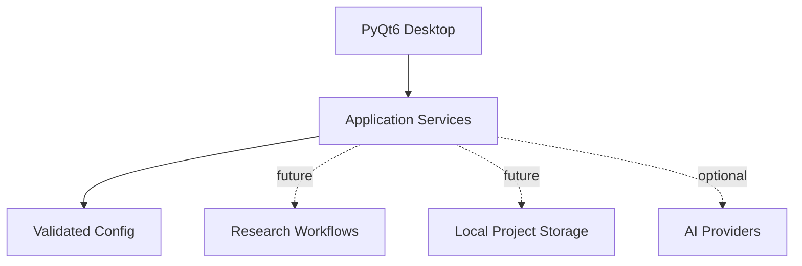

# ResearchWeave

**A free, local-first desktop workspace for reproducible research.**

  

ResearchWeave is being designed for the complete research journey: beginners learning to ask sound questions, analysts making defensible methodological decisions, and advanced researchers preserving the provenance of their work. The vision is a capable desktop environment with optional AI support, local storage, and transparent scientific workflows.

> **Bootstrap status:** A functional PyQt6 desktop welcome window, validated offline configuration, structured logging foundation, development checks, and scoped engineering skills exist. Research, AI, statistics, citations, encryption and sync features are still planned.

## Getting started

Install [uv](https://docs.astral.sh/uv/) and Python 3.12. In the repository:

```shell
uv sync --locked --extra dev
uv run researchweave
```

Once dependencies are installed, the desktop shell starts without an account, API keys, network access, or a local AI model. Initial dependency downloads need network access unless they are cached.

## What is available?

| Feature | Current state |
|---|---|
| Native desktop shell | Runs in PyQt6 |
| Offline default configuration | Implemented and validated |
| Sensitive-key logging redaction | Initial implementation |
| Research projects and literature management | Planned |
| Data analysis, systematic reviews, qualitative studies | Planned |
| Local/cloud AI and controlled agents | Planned |
| Encryption, collaboration, synchronization | Planned |

## Development and checks

```shell
uv run --extra dev python scripts/tasks.py lint
uv run --extra dev python scripts/tasks.py types
uv run --extra dev python scripts/tasks.py test
uv run --extra dev python scripts/tasks.py skills
uv run --extra dev pre-commit run --all-files
```

Testing includes an offscreen Qt window smoke test. See [developer notes](docs/development/README.md) and [architecture](docs/architecture/README.md).

## Code direction



ResearchWeave will enforce clear boundaries between Qt views, scientific algorithms, data stores and opt-in network integrations.

## Codex skills

Project-level skills reside under [`.agents/skills`](.agents/skills/) and are tracked in [the inventory](docs/SKILLS_INVENTORY.md). Run `uv run --extra dev python scripts/validate_skills.py` to check frontmatter, unique names, minimum substantive guidance, and local references. A new Codex session opened in this repository may be needed to discover added skills; global Codex settings are unnecessary.

## Contributing and security

Read [CONTRIBUTING.md](CONTRIBUTING.md), [AGENTS.md](AGENTS.md) and [SECURITY.md](SECURITY.md). Do not commit research subjects' data, private manuscripts, credentials or API keys. Planned exports and AI integrations must preserve consent and research provenance. See the [provisional threat model](docs/security/THREAT_MODEL.md).

## License

[GPL-3.0-only](LICENSE) provisionally, due to the GPL licensing of the free PyQt6 bindings. Dependency and binary redistribution obligations must be rechecked before release.
