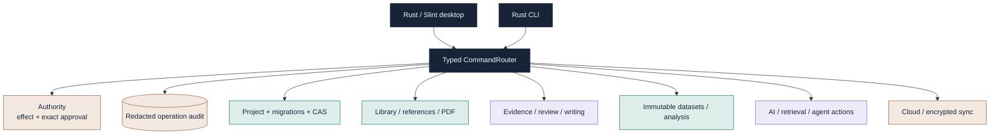

<p align="center">
  
</p>

<h1 align="center">ResearchWeave</h1>

<p align="center">
  <strong>A native, local-first research operating system built in Rust.</strong><br/>
  Evidence, literature, quantitative and qualitative analysis, writing, reproducibility, controlled AI, and secure project portability in one research workbench.
</p>

<p align="center">
  
  
  
  
</p>

<p align="center">
  
  
  
  
  
</p>

<p align="center">
  <a href="#downloads-and-release-status">Downloads</a> ·
  <a href="#what-researchweave-does">Capabilities</a> ·
  <a href="#real-rust-desktop">Screenshots</a> ·
  <a href="#architecture">Architecture</a> ·
  <a href="#build-from-source">Build</a> ·
  <a href="#verification-and-release-gates">Verification</a> ·
  <a href="#contributing">Contributing</a>
</p>


> [!IMPORTANT]
> **Rust release candidate status — 2026-10-26.** The current `main` workspace is the native Rust/Slint rewrite. The exact Windows candidate now has local source/security/SBOM, installed-package, PDFium, UIA, uninstall, hash-equivalence and performance evidence. The final public Rust release is intentionally blocked until the remaining native macOS/Linux, live Iranian S3 sync, platform-keyring and public release gates are supported by real evidence. The GitHub Releases page may still contain the legacy Python release until those gates pass.

## Downloads and release status

The final README contract is to put verified Rust downloads here. They are **not published yet**, because ResearchWeave does not label an artifact “release-ready” from source inspection alone.

| Platform | Planned Rust artifact | Current evidence | Public Rust download |
| --- | --- | --- | --- |
| Windows x64 | Native installer (`.exe`) | Exact installed candidate, verified PDFium runtime, project/PDF smoke, UIA, uninstall, hashes and local security/SBOM evidence are green | **Pending public release after cross-platform/provider gates** |
| macOS Apple Silicon | `.app` inside `.dmg` | Packaging implementation exists | **Pending native build + launch + GUI QA** |
| macOS Intel | `.app` inside `.dmg` | Packaging implementation exists | **Pending native build + launch + GUI QA** |
| Linux x86_64 | AppImage + Debian package | Packaging implementation exists | **Pending native package execution + GUI QA** |

When the Rust release is published, verified direct artifact links will replace the pending cells above. The repository release page is: <https://github.com/aradmanamnaoon/researchweave/releases>.

## What ResearchWeave is

ResearchWeave is designed as a **research workbench rather than a collection of disconnected utilities**. A project carries its evidence, source identities, revision history, datasets, analysis provenance, qualitative coding, manuscript state, audit trail, and optional AI context through a shared typed command boundary.

| Principle | What it means in the product |
| --- | --- |
| 🏠 **Local-first** | Core project work does not require an account, hosted backend, or AI provider. |
| 🧬 **One research object graph** | Sources, references, review records, extraction, datasets, codebooks, writing, and provenance are linked instead of copied between apps. |
| 🔬 **Scientific traceability** | Immutable dataset revisions, hashes, assumptions, complete-case accounting, bounded algorithms, and deterministic tests are first-class concerns. |
| 🤖 **AI with boundaries** | AI proposes and assists; sensitive writes/tool actions remain inspectable and approval-gated. |
| 🔐 **Privacy by architecture** | Private text and credentials are not dumped into audit logs or provider profile metadata. Cloud sync is opt-in and encrypts content locally before upload. |
| ⚡ **Native desktop** | The application runtime is Rust. Python is not hidden inside the shipped desktop app; Python helpers are limited to build/verification tooling where used. |

## The research workbench

The Rust UI uses six persistent activity roots. Each has its own original icon and keeps the application navigable even as specialized research screens grow.

| Activity | Visual | Research responsibility |
| --- | :---: | --- |
| **Home** |  | Start Center, project home, research question, protocol and project context |
| **Sources** |  | Library, references, native PDF reading, evidence anchors and review inputs |
| **Analyze** |  | Data import, immutable datasets, statistics, plots, qualitative coding and mixed methods |
| **Synthesize** |  | Notebook, manuscript, bibliography, publishing checks and research outputs |
| **Automate** |  | Assistant conversations, retrieval, agent proposals and controlled tool execution |
| **Manage** |  | Providers, diagnostics, activity history, backups, recovery, encrypted Cloud Sync and preferences |

The shell also provides a global `Ctrl+K` command path, persistent status context, Jobs/Notifications surfaces, responsive collapse behavior, dark/light/high-contrast modes, compact density, reduced motion, and 80–200% application text scaling.

## Real Rust desktop

These are captures from the **running Rust/Slint application**, not mockups and not screenshots from the legacy Python/PyQt build.

| Manuscript + DOCX | Native PDF reader |
| --- | --- |
|  |  |

| Project home | Activity rail / start center |
| --- | --- |
|  |  |

The current design system uses **Deep Ink** (`#172438`), **Research Teal** (`#147A75`), **Evidence Violet** (`#7564B5`), **Discovery Copper** (`#9A5B3A`) and **Soft Paper** (`#F6F5F1`). High-contrast mode replaces those semantic roles with non-color-dependent selection/focus cues. See [`docs/design/RESEARCHWEAVE_DESIGN_SYSTEM.md`](docs/design/RESEARCHWEAVE_DESIGN_SYSTEM.md).

## What ResearchWeave does

The current Rust workspace is split into 11 focused crates and exposes project-scoped capabilities through the shared command router. The high-level product surface is summarized below; detailed implementation status lives in [`docs/verification/FEATURE_EXPANSION.md`](docs/verification/FEATURE_EXPANSION.md).

### Projects, integrity and recovery

- versioned local project schema with migrations;
- revision/CAS checks for project mutations;
- chained event history and payload hashing;
- structural diagnostics for event-chain, object, body-hash and annotation integrity;
- payload-free project activity history with exact-operation filtering;
- local recovery snapshots/journals and portable project/archive workflows;
- encrypted archive support and bounded recovery flows;
- writing crash journal with atomic Windows replacement and automatic retry after abrupt exit.

### Sources, references and evidence

- local UTF-8 source storage with content-addressed objects;
- reference creation/import/export and bibliography preview;
- citation links, revocation, citation graph and GraphML export;
- native PDFium rendering/text mapping and persisted highlight/relocation infrastructure;
- question and protocol version history;
- review records, blinded screening state, adjudication/extraction infrastructure and derived PRISMA accounting;
- versioned typed extraction forms and persisted validated values;
- qualitative codebooks and character-offset annotations bound to verified source text.

### Data and quantitative analysis

Native data ingestion currently includes:

| Family | Supported Rust paths |
| --- | --- |
| Delimited | CSV, TSV |
| Spreadsheet | XLSX, ODS |
| Columnar | Parquet |
| Statistical packages | SPSS SAV/ZSAV, Stata DTA |

Imported datasets are stored as immutable revisions with a stable dataset identity and source hash. Analysis paths preserve revision/hash provenance rather than silently mutating a dataset in place.

Implemented statistical breadth includes descriptive/frequency analysis, correlations, hypothesis tests, multiple-testing adjustment, regression/GLM families, logistic and Poisson models, survival/log-rank, meta-analysis, psychometrics/reliability and scale scoring, power/sample-size routines, PCA, seeded k-means, deterministic hierarchical clustering, survey estimates, DID, GEE, time-series features, missingness/imputation workflows and deterministic SVG/PNG plots. Individual methods still have their own assumptions, resource bounds and validation limits; “implemented” is not a claim of universal statistical suitability.

The current native Statistics workbench uses progressive disclosure rather than a single expert-option wall. Windows UI Automation exercises descriptives, categorical frequency tables, Pearson correlation, explicit two-group Welch t tests and HC3-robust OLS against immutable dataset revisions. Human-readable summaries show key estimates/sample counts/provenance first while the full verified result payload remains available for audit.

<p align="center">
  
</p>

### Qualitative and mixed methods

Qualitative state is stored inside the project rather than as loose UI state. Codebook mutations are optimistic-concurrency guarded by the qualitative content hash, annotations verify source/body hashes and exact character spans, and coder-agreement helpers are explicit about fixed-unit assumptions.

The mixed-methods bridge now has a **trusted host composition path**: the desktop reloads persisted transcript→case mappings and the current verified coding snapshot itself, then joins them to an immutable quantitative dataset revision. The client is not allowed to inject its own coding hash, case map or excerpt payload. Current joint displays are descriptive and carry an explicit non-causal limitation.

### Systematic review workflow

ResearchWeave supports a persisted chain from reference identity to review record, blinded screening vote, typed extraction and derived PRISMA state. Windows UI Automation exercises that path through the real desktop. Broader multi-user ACL, reversible deduplication, full-text conflict/adjudication depth and review-specific AI evaluation remain active expansion work rather than silently claimed parity.

### Manuscript and publishing

The current native writing workflow includes:

- project-scoped notebook save/history/export;
- manuscript ID + section + citations + body revisions;
- synchronous crash journal plus debounced routed persistence;
- section history/restore and manuscript inspection;
- bibliography/readiness checks;
- Markdown, HTML, DOCX and PDF manuscript export;
- deterministic DOCX structure tests;
- draft submission ZIP generation including `manuscript.docx`, bibliography/manifest information, hashes and an explicit `submission_performed=false` receipt.

The editor is intentionally described as a **structured versioned manuscript editor**, not yet a Word-class page-layout engine. Track changes, comments, rich document trees, cross-references, footnotes/equations and journal-template fidelity remain product work.

## AI without silent autonomy

AI is optional. ResearchWeave keeps AI behind the same project/approval model instead of giving a model direct ambient write access.

Current Rust AI infrastructure includes provider metadata/profile management, local OpenAI-compatible and Ollama-oriented adapters, hosted-provider policy checks, durable project conversations, prompt templates, local lexical retrieval with source/revision provenance, retrieval source revocation, bounded agent plans and exact-fingerprint one-use approvals for actions.

Important boundaries:

- provider profiles are **secret-free metadata**; credentials are not returned in profile lists;
- credential-bearing endpoint URLs are rejected;
- offline/egress policy is checked before remote credential resolution;
- project/source text remains untrusted prompt content rather than trusted system instruction;
- agent plans are inert until explicitly approved;
- router audit stores operation metadata/hashes rather than private raw arguments;
- current retrieval is local lexical retrieval, not an exaggerated “semantic RAG” claim;
- provider list/configuration does not imply a live connectivity check unless one was explicitly performed.

See [`docs/verification/AI_CAPABILITIES.md`](docs/verification/AI_CAPABILITIES.md) for the evidence-backed capability matrix and open evaluation work.

## Cloud sync, encryption and portability

ResearchWeave contains a generic S3-compatible cloud/sync layer with locally encrypted content, conflict-aware semantics, history/restore infrastructure and credential indirection. The native desktop now exposes a dedicated **Cloud Sync** screen for profile setup, OS-credential-store secrets, connection/conditional-write checks, encrypted push/pull, history, restore-as-copy, conflict review and optional automatic sync. Automatic sync is fail-closed: if the remote revision no longer matches the last reviewed/successful revision, it disables itself and preserves the conflict rather than silently choosing a winner. Cloud use is opt-in; no cloud credential is hardcoded into the repository or profile JSON.

The final release still requires live evidence for an Iranian S3-compatible provider, including real conditional-write behavior, encrypted push/pull, conflict/history handling and second-device restore. **Liara is the preferred documented target, but the README does not present live provider acceptance as complete until those tests are actually observed.** ArvanCloud remains non-authoritative unless its exact semantics are freshly verified.

## Research lifecycle


## Architecture



The command envelope binds operation, project, request identity, arguments, actor and revision context. Read operations can run without a write approval. Mutating/sensitive operations use effect-aware approval semantics; local writes remain revision-guarded where the domain contract requires it. Higher-level desktop composition routes can combine trusted domain reads without accepting provenance objects from untrusted caller arguments.

## Security and privacy model

ResearchWeave is not “secure because it is offline.” Security behavior is implemented as explicit boundaries:

- project mutations use revision/CAS checks rather than last-write-wins assumptions;
- event integrity is hash-chained and diagnostics report structural failures without dumping raw private text;
- provider metadata is bounded/redacted and credential-bearing URLs are rejected;
- cloud content is encrypted before upload;
- sync must not silently overwrite conflicts;
- sensitive exports/tools require the appropriate router effect/approval path;
- audit records avoid private operation payloads;
- recovery and archive paths verify hashes rather than trusting filenames;
- the Windows writing/activity preference journals use replacement semantics designed not to report failed replacements as successful writes.

Threat-model and release evidence live under [`docs/security`](docs/security/) and [`docs/verification/rust-rewrite`](docs/verification/rust-rewrite/).

## Accessibility and visual quality

The UI treats accessibility and visual quality as release criteria, not optional polish.

Current Windows evidence covers meaningful UI Automation names/roles, Invoke semantics, keyboard command access, Unicode/Persian text transport, light/dark/high-contrast states, persisted text scaling up to 200%, responsive minimum/medium/narrow layouts, non-overlapping six-section navigation and privacy sentinels on diagnostics/provider surfaces.

The design contract requires visible focus, keyboard activation, non-color status cues, semantic chart labels/data and real rendered inspection after UI changes. Real NVDA, VoiceOver and Orca certification remains platform-specific work; macOS/Linux accessibility is not claimed from Windows UIA evidence.

## Native packaging

The Rust application runtime has no hidden Python/PyQt dependency. Packaging helpers may use Python or shell tooling to stage binaries, verify archives and invoke native packagers; the shipped desktop executable itself is Rust.

| Platform | Native packaging implementation |
| --- | --- |
| Windows | Release binary + verified PDFium runtime + Inno Setup installer + installed smoke/UIA harness |
| macOS arm64/x64 | `.app` bundle, embedded `libpdfium.dylib`, `.icns` brand icon and DMG generation |
| Linux x64 | Debian package, `.desktop` launcher, embedded `libpdfium.so` and AppImage generation |

PDFium release assets are pinned and hash-verified before packaging. Runtime notices are kept in [`packaging/rust/PDFIUM_RUNTIME_NOTICES.md`](packaging/rust/PDFIUM_RUNTIME_NOTICES.md).

## Build from source

### Prerequisites

- Rust **1.94.1** (workspace `rust-version`);
- a supported native desktop toolchain for your OS;
- Git;
- PDFium only if you want the native PDF reader during development.

### Desktop

```powershell
rustup toolchain install 1.94.1
rustup override set 1.94.1
cargo build --locked -p researchweave-desktop
cargo run --locked -p researchweave-desktop
```

On Windows, fetch the pinned PDFium runtime with:

```powershell
powershell -ExecutionPolicy Bypass -File packaging/rust/fetch-pdfium-win-x64.ps1
```

The desktop searches the packaged location, `PDFIUM_LIB_PATH`, and the repository `target/pdfium/...` development locations for the correct native library.

### CLI

```powershell
cargo run --locked -p researchweave-cli -- --help
```

## Verification and release gates

ResearchWeave intentionally distinguishes **implemented**, **tested**, **locally verified**, and **release verified**.

Freshly observed during the current Rust completion pass includes a full **26/26 desktop Rust test pass**, strict desktop Clippy with warnings denied, a successful desktop build, and a complete broad Windows UIA smoke against the rebuilt executable. That UIA run covers project creation/open, Unicode editing, question/protocol/review/extraction, immutable data import, progressive-disclosure Statistics (descriptives, frequency, Pearson, Welch t and HC3 OLS), Variable View, persisted Analysis Results/report replay, Qualitative transcript→case controls, the trusted Mixed Methods route, manuscript persistence/export, abrupt-exit recovery, publishing, local Agent state, responsive navigation, high contrast and 200% scaling. Diagnostics, payload-free Activity history and provider-profile CRUD/restart/privacy also have a fresh dedicated Windows UIA pass.

The current exact worktree has freshly passed the full source gates below; they remain the required commands for any later candidate-changing source edit:

```powershell
cargo fmt --all -- --check
cargo test --workspace --locked --all-features
cargo clippy --workspace --all-targets --all-features --locked -- -D warnings
cargo build --workspace --locked
```

Local exact-candidate security/supply-chain verification also passed `cargo audit`, `cargo deny`, a complete Git-visible + history Gitleaks scan, CycloneDX generation, dependency/license/source policy, exact package hashes and installed Windows package smoke/UIA. These local results do **not** substitute for the missing macOS/Linux native matrix or live provider acceptance. See [`docs/verification/REGRESSION_RESULTS.md`](docs/verification/REGRESSION_RESULTS.md) and [`docs/verification/rust-rewrite/release-candidate-gates.md`](docs/verification/rust-rewrite/release-candidate-gates.md).

### Remaining release-blocking evidence

The project does **not** fabricate evidence for environments or services that were not exercised. The final public Rust release remains blocked on:

- native macOS arm64/x64 package build, launch and rendered GUI QA;
- native Linux AppImage/DEB execution and rendered GUI QA;
- live Iranian S3 conditional-write behavior;
- encrypted sync push/pull/conflict/history and second-device restore;
- macOS/Linux OS-keyring evidence;
- GitHub-hosted/native cross-platform candidate verification before publication;
- signing/notarization where credentials are available;
- final README artifact links and native-platform Rust screenshots.

## Repository map

```text
crates/
  researchweave-core/       typed command router, authority, audit
  researchweave-project/    project schema, revisions, migrations, diagnostics
  researchweave-library/    sources, references, relations, search
  researchweave-evidence/   question/protocol/review/qualitative/writing/publishing
  researchweave-analysis/   immutable datasets, statistics, plots, native formats
  researchweave-ai/         providers, conversations, retrieval, agent actions
  researchweave-crypto/     cryptographic primitives
  researchweave-cloud/      S3-compatible provider layer
  researchweave-sync/       encrypted sync/conflict/history behavior
  researchweave-desktop/    Slint desktop workbench
  researchweave-cli/        native CLI surface

assets/                     brand, icons, public Rust screenshots
docs/                       design, security, research and verification evidence
packaging/rust/             native package staging/build/smoke helpers
scripts/rust_rewrite/       rewrite/release verification helpers
.github/workflows/          Rust quality and release-candidate workflows
```

## Evidence-backed product matrices

| Document | Purpose |
| --- | --- |
| [`FEATURE_EXPANSION.md`](docs/verification/FEATURE_EXPANSION.md) | 45 high-value product expansion slices mapped to live implementation status |
| [`COMPETITIVE_FEATURE_PARITY.md`](docs/research/COMPETITIVE_FEATURE_PARITY.md) | Research-app parity/market research used to drive expansion priorities |
| [`UI_UX_AUDIT.md`](docs/verification/UI_UX_AUDIT.md) | Rendered UI defects, fixes and unresolved visual/accessibility work |
| [`INTERACTION_TEST_MATRIX.md`](docs/verification/INTERACTION_TEST_MATRIX.md) | Real desktop interaction coverage vs. unverified interactions |
| [`DOCX_EXPORT_MATRIX.md`](docs/verification/DOCX_EXPORT_MATRIX.md) | Manuscript/DOCX behavior, tests and remaining fidelity gaps |
| [`AI_CAPABILITIES.md`](docs/verification/AI_CAPABILITIES.md) | AI/provider/retrieval/agent boundaries and evaluation requirements |
| [`PERFORMANCE_BENCHMARKS.md`](docs/verification/PERFORMANCE_BENCHMARKS.md) | Reproducible native performance budgets and still-unmeasured baselines |
| [`REGRESSION_RESULTS.md`](docs/verification/REGRESSION_RESULTS.md) | Fresh vs. carried test evidence and open final gates |
| [`RESEARCHWEAVE_DESIGN_SYSTEM.md`](docs/design/RESEARCHWEAVE_DESIGN_SYSTEM.md) | Brand palette, activity navigation, typography, density and accessibility rules |

## Current product boundaries

ResearchWeave already has broad working infrastructure, but the repository intentionally keeps ambitious gaps visible. Examples include Word-class track changes/comments, a fully rich document tree, reversible reference deduplication, semantic/hybrid retrieval, AI screening/extraction evaluation, executable notebook kernels, Bayesian/multilevel breadth, media timeline coding, external knowledge-base round-trip and advanced knowledge-graph workflows.

Those are tracked as product work rather than represented by placeholder buttons or inflated README claims.

## Contributing

Start with [`CONTRIBUTING.md`](CONTRIBUTING.md), [`AGENTS.md`](AGENTS.md) and the design/verification matrices above. Changes should preserve project compatibility, revision/CAS integrity, auditability, privacy boundaries and existing research data.

For scientific code, include deterministic fixtures or independent numerical oracles where appropriate, document assumptions/resource limits, prevent leakage/data-reuse mistakes, and avoid tests that merely reproduce the implementation under test.

For desktop changes, exercise the real rendered UI, keyboard/accessibility semantics and responsive states. A control existing in Slint source is not sufficient GUI acceptance.

Do not commit credentials, private manuscripts, participant data, unpublished research material, API secrets, local cloud profiles, disposable QA workspaces or generated native binaries unless the release process explicitly requires them.

## Security

Please use [`SECURITY.md`](SECURITY.md) for vulnerability reporting. Do not open a public issue containing credentials, private datasets, unpublished manuscripts or exploit details that would expose users.

## License and citation

ResearchWeave is licensed under **GPL-3.0-only**. See [`LICENSE`](LICENSE).

Citation metadata is available in [`CITATION.cff`](CITATION.cff). If you use ResearchWeave in research, cite the software version/commit you actually used and retain the exported project/dataset provenance needed to reproduce your workflow.

---

<p align="center">
  <strong>ResearchWeave</strong><br/>
  <span>Local evidence · explicit provenance · native analysis · controlled automation</span>
</p>
