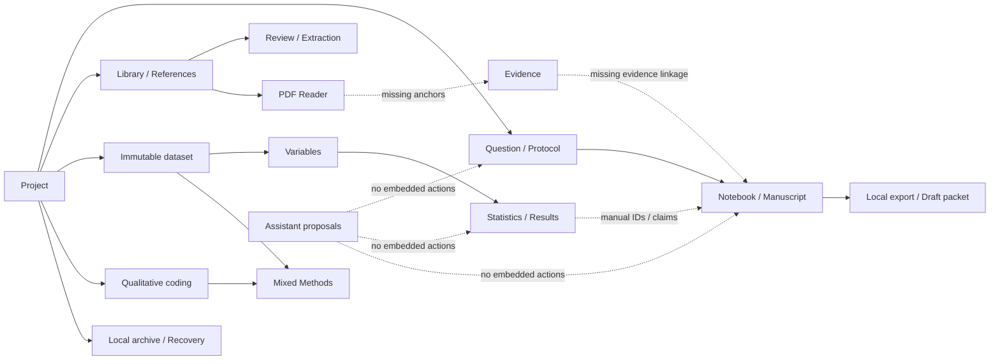

# ResearchWeave — current workflow inventory and broken handoffs

**Basis:** Rust desktop Slint and callback handlers at initial `976656d` snapshot. Status terms: **wired** means a concrete UI callback exists, **partial** means a major handoff/user experience is missing, **placeholder** means no dedicated UI. These are static observations; historical tests are linked separately.

| Workflow | Actual UI route and action sequence | Existing state/authority behavior | Missing handoff / usability issue | Baseline |
|---|---|---|---|---|
| First launch/project | Home → Welcome (0) → managed Create **or** custom path/title Create/Open → Project Home (1) → Metadata (39) | Real callbacks `create-default-project`, `create-project`, `open-project`, `preview-project-metadata`, `apply-project-metadata` (`main.slint:736-926,2239-2278`; `main.rs:6851-6931`) | Default create avoids an absolute path; reopening still uses explicit path, with no recent list, native folder dialog or templates. | Wired; onboarding partial |
| Question → protocol | Home → Question (2): refresh, preview, record, history → Protocol (4): preview, record, amend, version export, save | Both go through project-scoped preview/record handler; explicit Markdown save is separate (`main.slint:1237-1346`) | Protocol does not automatically bring current question ID into a structured editor; users copy IDs and navigate screens. | Wired; context partial |
| Source → read → evidence | Sources → Library (5): add title/body, list → PDF Reader (7): native pick, open, search, pages → Evidence (8) | Library and PDF calls are real (`main.slint:927-1101`); PDF inspector states selection/annotations pending | Library item does not open a linked rich reader; Evidence route is placeholder; source anchor and citation workflow cannot complete in this UI. | **Blocked at Evidence** |
| Reference → systematic review → PRISMA → extraction | References (20): preview/record record → Review (9): register reference, screening vote, review status → PRISMA (10): counts → Extraction (11): JSON schema/revision/values | Preview/record + persisted-state counts are wired (`main.slint:1347-1381,1401-1487`) | Multiple free-form IDs and reviewer names; no screening queue, visual PRISMA, extraction form designer, source/context carry. | Wired; high friction |
| Import → variable quality → statistics | Analyze → Data (12): pick/import/inspect → Variables (13): inspect metadata and create revision → Statistics (14): choose one of five methods/run | Immutable dataset revision and preview/approval (`main.slint:1488-1685`); historical Windows UIA claims in `docs/verification/INTERACTION_TEST_MATRIX.md` | Dataset/revision IDs must be copied between screens; no data table, column picker, plots or assumption-rich inspector. | Wired; handoff partial |
| Statistics → result replay → report | Statistics (14): calculate → Analysis Results (15): re-enter dataset/revision, preview/record result, inspect by result ID, replay script, render report | Result persistence and deterministic report UI callbacks (`main.slint:1577-1772`) | Running an analysis does not open a selected result object/tab with exact method config; reports mostly text. | Wired; handoff partial |
| Qualitative code → annotation → mixed joint display | Qualitative (16): inspect content hash, map transcript/case, annotate source offsets or kappa → Codebook (17): enter expected hash and code fields → Mixed Methods (18): enter dataset/revision/case/measure/code | Explicit source/body hash and persisted mapping checks; mixed method prohibits caller-provided provenance (`main.slint:1773-1915`) | Manual hashes/offsets/JSON instead of selecting text/codes, no visual code tree, joint-display table or case explorer. | Wired; editing UX partial |
| Notebook → manuscript → publish/export | Notebook (21): type, preview/save/history/Markdown export → Manuscript (19): section/body/citations, preview/record/inspect, prepare Markdown/DOCX/HTML/PDF then save → Publishing (22): readiness/bibliography/draft ZIP/save | Writing recovery journal + debounced project save in `writing_autosave.rs`, callback in `main.rs`; export refuses overwrite (`main.slint:1382-1400,1916-2100`) | Notes lack note cards/tags/search; manuscript is one text body and IDs, no page editor/rich formatting; citations not a contextual picker; no dynamic claim-evidence inspector. | Wired; **Word/Keep UX absent** |
| AI conversation → tool proposal | Automate → Agent (23): manually create conversation/messages/templates; plan, stage retrieval action, approve/deny, separately execute; Manage → Providers (24): validate/configure profiles | Exact project/fingerprint binding and separate approval/execute (`main.rs:5310-5465`), offline provider validation (`main.slint:2101-2186`) | No AI affordances in Library/Question/Analysis/Writing/Review; conversational output/streaming/provider runtime absent from tested shell; requires manual IDs/JSON. | Wired local scaffolding; **contextual AI absent** |
| Backup → verify → restore | Manage → Backups (28): absolute path + optional password, export/verify → Recovery (29): archive/destination/password, restore into new directory | Encryption/verification and no-overwrite recovery semantics (`main.slint:1144-1236`, `main.rs:2550-2754`) | Native pickers, guided backup location/history, password visibility/validation and restore progress absent. No cloud requirement: local-only storage supersedes prior cloud sync. | Wired; recovery UX partial |
| Troubleshoot/work status | Manage → Diagnostics (30): run checks; Activity (37): filter/paginate local events; Automate → Jobs (31), Notifications (32); global tray | Structured diagnostics read and persisted PDF job/notification history (`main.slint:2187-2238,2326-2403`) | General long-running job/cancel/retry, error diagnostics, artifact links, guided repair and persistent problem center absent. | Wired; service-level UX partial |
| Personalization/navigation | Manage → Preferences (36): dark/contrast/compact/reduced motion/scale; F6 focus landmark cycle; Ctrl+K + prefix + Enter route; Shift+F6 reverse | Local display persistence, 40 destination registry (`main.slint:378-444,1102-1143`, `main.rs:576-648`) | No interactive command result list, recent-object history, configurable shortcuts, keyboard tests on all OSes. | Wired; command UX partial |

## Cross-workflow dependency map

**Most consequential missing links:** source selection→evidence anchor→verified manuscript citation; selected dataset revision→one analysis document→saved result; note card→writing document; current task context→AI proposal. `docs/ux/SCREEN_INVENTORY.md` provides route-level details, `AI_INTEGRATION_AUDIT.md` records permission constraints, and `UX_ACCEPTANCE_CRITERIA.md` provides the future stage gate.

## Test evidence policy

`docs/verification/INTERACTION_TEST_MATRIX.md` reports previously observed Windows UIA workflows and explicitly identifies native macOS/Linux gaps. No workflow in this document is labeled **passed now**: this is a code-inspected initial audit, with no new binary launch or UIA run. For future testing, use one synthetic dataset/review and capture the exact project ID/revision, event/audit trail, task completion, error and screenshot on the same candidate build.
