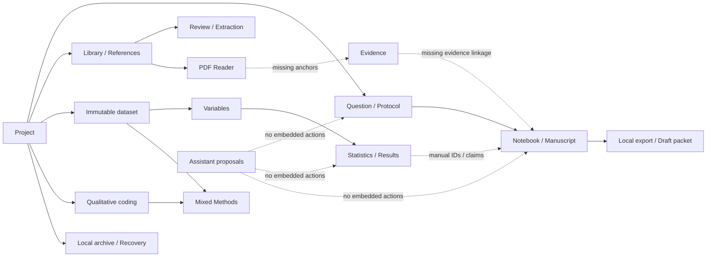

# ResearchWeave — current workflow inventory and broken handoffs

**LATEST tested native workflows — vendored AccessKit candidate:** Linux binary `9fa1269b23fc28516bf1564288bf00a7ee2a836641d5d6da1601d9dd2bee67b5` **strict Reader [r6 overall PASS](screenshots/search-reader-accesskit-pass-r6/results.json)** (16,916 Unicode scalars / 29,252 bytes over 8k+8k+916 pages, 53 GUI-created sources over 50+3 list pages, [16/16 correct AT-SPI enabled/sensitive checks](screenshots/search-reader-accesskit-pass-r6/accessibility-states.json), zero mismatches, **four inert disabled boundary clicks**, 13 screenshots). [r9 40/40 route/zero placeholder PASS](screenshots/native-40-accesskit-r9/results.json) (46 screenshots), [r10 7/7 utility links + source-bound human Evidence note approval/record/history PASS](screenshots/utility-evidence-accesskit-r10/results.json) (21 screenshots). Earlier `499cfebb...` [strict r4 FAIL](screenshots/search-reader-accessibility-fail-r4/FAIL.txt) is **historical**, superseded by new vendor-level fix. Local MIT/Apache-2.0 `accesskit_atspi_common` 0.19.1 [override](../../vendor/accesskit_atspi_common/src/node.rs) / [Cargo patch](../../Cargo.toml) preserves ReadOnly and correctly gates Enabled/Sensitive; monitor upstream parity/rebase/override removal. Route visits are not 40 completed tasks; actual human screen-reader, cross-OS installed, scientific/citation/security and release gates remain. v0.2.0 unchanged.

**HISTORICAL pre-vendor strict Reader r4 FAIL (superseded by new strict r6 PASS):** The earlier binary `499cfebb...` passed Unicode content and source-list pagination but FAILED six of 16 native disabled AT-SPI enabled-state checks. Retain [historical r4 failure](screenshots/search-reader-accessibility-fail-r4/FAIL.txt) and [state comparisons](screenshots/search-reader-accessibility-fail-r4/accessibility-states.json). On new vendored binary `9fa126...`, [strict Reader r6 PASS](screenshots/search-reader-accesskit-pass-r6/results.json) verified 16/16 states, zero mismatches and 4/4 inert disabled clicks. This pre-vendor regression is resolved within the new Linux test scope; other release gates remain open.

**Historical baseline basis:** Rust desktop Slint and callback handlers at initial `976656d` snapshot. The historical table and diagram below retain their former missing handoffs; their old statements about Search, Reader, Evidence, utility routes, contextual AI and the data grid are superseded by later source changes. Draft [PR #16](https://github.com/aradmanamnaoon/researchweave/pull/16) was based on historical checkpoint `af48b4f67c5a9f13b71ea623586d6f9c9bc4e37e` when the safety edits were still uncommitted. **The r5 functional and r6 full-route private Linux GUI harnesses both PASSED on the same later binary `707b1c...`; independent build provenance and final committed/cross-OS checks remain pending.** A wired callback alone is not proof of task success.

## Current candidate changes — 29 October 2026

| Workflow | Current verified source behavior | Test boundary |
|---|---|---|
| Library → Search (3) → Reader (6) | Rust-backed, project-local literal text search with result-to-reader navigation; Reader has a 50-item paginated source index and 8,000-Unicode-character verified-text pages. See `main.slint` and desktop `on_search_project_sources`, `on_load_reader_source_list`, `on_open_reader_source`, `on_load_reader_page` calling library `search.query`, `library.list` and `source.full_text`. | **Compiled, backend-tested, and passed a real isolated Linux/Xvfb synthetic Search → Reader GUI run** on 207 Unicode characters, including empty/invalid input, list reopen and return navigation. Long pagination and Windows/macOS remain unverified. |
| Reader / PDF → Evidence (8) | Reader displays stored source text; PDF Reader still renders separate PDF pages. Evidence (8) now offers a real saved-source chooser and a human-authored, source-bound `evidence.note` preview→approved record→actual note-ID history through the Rust evidence handler. It does **not** verify quotations, PDF offsets or manuscript citations. | **r5 native Linux GUI PASS:** created an actual synthetic stored source, opened Reader, previewed a human note, completed scoped approval, recorded the note, read persisted UUID-based history (one revision) and returned to Reader. [r5 manifest + 21 hashed captures](screenshots/utility-evidence-xvfb/results.json). Multiple revisions, PDF anchors, wrong-surface/stale approval variants and claim citations still pending. |
| Seven utility pages (25, 26, 27, 33, 34, 35, 38) → real workspaces | Dedicated Privacy/Integrations/Exports/Tutorials/Guidance/Shortcuts/About cards link to existing metadata, providers, approved assistant actions, library, readers, Data, Manuscript, Notebook, publishing, backup/recovery, diagnostics, preference and activity routes. These are **links and guidance**, not a new security engine, automatic OAuth, sync or external submission. | **r5 native Linux GUI PASS: 7/7 linked destinations** observed for Privacy→Project Metadata, Integrations→Providers, Exports→Manuscript, Tutorials→Welcome, Guidance→Project Metadata, Shortcuts→Search, About→Diagnostics. Link destination reachability does not test every operation inside each destination, privacy claim, keyboard/Orca usability or other OSes. |
| Dataset → Data View | Newer unreleased UI binds verified immutable data to a read-only `StandardTableView` with 25-row page controls. | Fresh private Linux/Xvfb populated-grid case **PASS**; second-page, large-dataset, installed-package and complete analysis workflow acceptance still pending. |
| Manuscript and contextual AI | Unreleased UI includes long-form manuscript editing, optional local-model-only AI panel and a selected found-text preview path. | Fresh private Xvfb synthetic 15-page Unicode manuscript and exact found-text AI preview cases **PASS**; no Word-class layout, citation-grounded model response or hosted inference verified. |

**Candidate chronology:** Earlier binary `77295db0109768f108495a31d932238431aeb0a86988325a63dd4258318023c7` passed **40/40 navigation with eight then-existing placeholders** and an independent **207-character Search → Reader GUI PASS** ([receipt](screenshots/search-reader-xvfb/results.json)). A later pre-safety binary `72ebceea6d67d758e223712ab01daa28083d2ebf514249554599463927a290e3` passed **40/40 AT-SPI routes, zero explicit placeholders** ([historical receipt](screenshots/native-40-routes-20261029/results.json)). The **earlier** binary SHA-256 `707b1c43446cc86f8e25da28954b90b18864613434b7600e1c57296a0180916d` passed the **r5 functional utility/Evidence harness** and subsequent **r6 40/40 full-route audit with zero placeholders**, under separate private WSL receipt directories. Historical Slint/host source SHA-256 matched both r5/r6 manifests and remained unchanged during execution; independent binary build provenance is still required. The earlier r3 utility/Evidence test FAIL from project-vs-note revision mismatch stays historical. **193 Windows workspace tests, formatting and strict Clippy passed on the working source**, but final installed/cross-OS/hosted gates remain. No new release: public Rust `v0.2.0` is unchanged. See [cross-platform QA](CROSS_PLATFORM_QA.md).

## Original workflow comparison — **historical** `976656d` source (not current functional inventory)

| Workflow | Actual UI route and action sequence | Existing state/authority behavior | Missing handoff / usability issue | Baseline |
|---|---|---|---|---|
| First launch/project | Home → Welcome (0) → managed Create **or** custom path/title Create/Open → Project Home (1) → Metadata (39) | Real callbacks `create-default-project`, `create-project`, `open-project`, `preview-project-metadata`, `apply-project-metadata` (`main.slint:736-926,2239-2278`; `main.rs:6851-6931`) | Default create avoids an absolute path; reopening still uses explicit path, with no recent list, native folder dialog or templates. | Wired; onboarding partial |
| Question → protocol | Home → Question (2): refresh, preview, record, history → Protocol (4): preview, record, amend, version export, save | Both go through project-scoped preview/record handler; explicit Markdown save is separate (`main.slint:1237-1346`) | Protocol does not automatically bring current question ID into a structured editor; users copy IDs and navigate screens. | Wired; context partial |
| Source → read → evidence | Sources → Library (5): add title/body, list → PDF Reader (7): native pick, open, search, pages → Evidence (8) | Library and PDF calls are real (`main.slint:927-1101`); PDF inspector states selection/annotations pending | Library item does not open a linked rich reader; Evidence route is placeholder; source anchor and citation workflow cannot complete in this UI. | **Blocked at Evidence** |
| Reference → systematic review → PRISMA → extraction | References (20): preview/record record → Review (9): register reference, screening vote, review status → PRISMA (10): counts → Extraction (11): JSON schema/revision/values | Preview/record + persisted-state counts are wired (`main.slint:1347-1381,1401-1487`) | Multiple free-form IDs and reviewer names; no screening queue, visual PRISMA, extraction form designer, source/context carry. | Wired; high friction |
| Import → variable quality → statistics | Analyze → Data (12): pick/import/inspect → Variables (13): inspect metadata and create revision → Statistics (14): choose one of five methods/run | Immutable dataset revision and preview/approval (`main.slint:1488-1685`); historical Windows UIA claims in `docs/verification/INTERACTION_TEST_MATRIX.md` | Dataset/revision IDs must be copied between screens; no data table, column picker, plots or assumption-rich inspector. | Wired; handoff partial |
| Statistics → result replay → report | Statistics (14): calculate → Analysis Results (15): re-enter dataset/revision, preview/record result, inspect by result ID, replay script, render report | Result persistence and deterministic report UI callbacks (`main.slint:1577-1772`) | Running an analysis does not open a selected result object/tab with exact method config; reports mostly text. | Wired; handoff partial |
| Qualitative code → annotation → mixed joint display | Qualitative (16): inspect content hash, map transcript/case, annotate source offsets or kappa → Codebook (17): enter expected hash and code fields → Mixed Methods (18): enter dataset/revision/case/measure/code | Explicit source/body hash and persisted mapping checks; mixed method prohibits caller-provided provenance (`main.slint:1773-1915`) | Manual hashes/offsets/JSON instead of selecting text/codes, no visual code tree, joint-display table or case explorer. | Wired; editing UX partial |
| Notebook → manuscript → publish/export | Notebook (21): type, preview/save/history/Markdown export → Manuscript (19): section/body/citations, preview/record/inspect, prepare Markdown/DOCX/HTML/PDF then save → Publishing (22): readiness/bibliography/draft ZIP/save | Writing recovery journal + debounced project save in `writing_autosave.rs`, callback in `main.rs`; export refuses overwrite (`main.slint:1382-1400,1916-2100`) | Notes lack note cards/tags/search; manuscript is one text body and IDs, no page editor/rich formatting; citations not a contextual picker; no dynamic claim-evidence inspector. | Wired; **Word/Keep UX absent** |
| AI conversation → tool proposal | Automate → Agent (23): manually create conversation/messages/templates; plan, stage retrieval action, approve/deny, separately execute; Manage → Providers (24): validate/configure profiles | Exact project/fingerprint binding and separate approval/execute (`main.rs:5310-5465`), offline provider validation (`main.slint:2101-2186`) | No AI affordances in Library/Question/Analysis/Writing/Review; conversational output/streaming/provider runtime absent from tested shell; requires manual IDs/JSON. | Wired local scaffolding; **contextual AI absent** |
| Backup → verify → restore | Manage → Backups (28): absolute path + optional password, export/verify → Recovery (29): archive/destination/password, restore into new directory | Encryption/verification and no-overwrite recovery semantics (`main.slint:1144-1236`, `main.rs:2550-2754`) | Native pickers, guided backup location/history, password visibility/validation and restore progress absent. No cloud requirement: local-only storage supersedes prior cloud sync. | Wired; recovery UX partial |
| Troubleshoot/work status | Manage → Diagnostics (30): run checks; Activity (37): filter/paginate local events; Automate → Jobs (31), Notifications (32); global tray | Structured diagnostics read and persisted PDF job/notification history (`main.slint:2187-2238,2326-2403`) | General long-running job/cancel/retry, error diagnostics, artifact links, guided repair and persistent problem center absent. | Wired; service-level UX partial |
| Personalization/navigation | Manage → Preferences (36): dark/contrast/compact/reduced motion/scale; F6 focus landmark cycle; Ctrl+K + prefix + Enter route; Shift+F6 reverse | Local display persistence, 40 destination registry (`main.slint:378-444,1102-1143`, `main.rs:576-648`) | No interactive command result list, recent-object history, configurable shortcuts, keyboard tests on all OSes. | Wired; command UX partial |

## Cross-workflow dependency map — historical missing handoffs (Evidence note linking is now present; verified quotes/claims still absent)

**Still-consequential missing or unverified links:** Reader selection→evidence anchor→verified manuscript citation; selected dataset revision→one analysis document→saved result; note card→writing document; optional AI preview→a verified, provenance-aware model response. Source Search → Reader passed a limited synthetic Linux GUI task; long documents and cross-OS behavior remain untested. `docs/ux/SCREEN_INVENTORY.md` provides route-level details, `AI_INTEGRATION_AUDIT.md` records permission constraints, and `UX_ACCEPTANCE_CRITERIA.md` provides the future stage gate.

## Test evidence policy

`docs/verification/INTERACTION_TEST_MATRIX.md` reports previously observed Windows UIA workflows and explicitly identifies native macOS/Linux gaps. The **original baseline table** is a code-inspected audit and certifies no new workflows. The **later candidate addendum** above records separately reported scoped native/Xvfb passes, including a real synthetic Search → Reader run with a short Unicode source. For future testing, use one synthetic dataset/review and capture the exact project ID/revision, event/audit trail, task completion, error and screenshot on the same candidate build.
