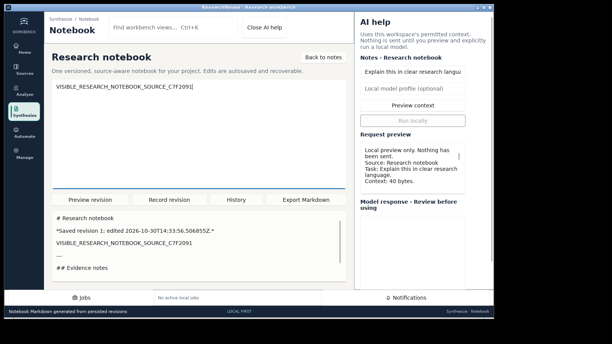
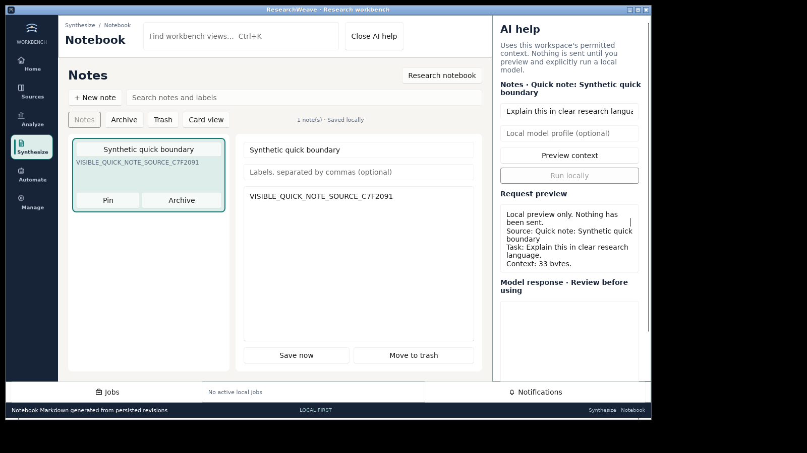
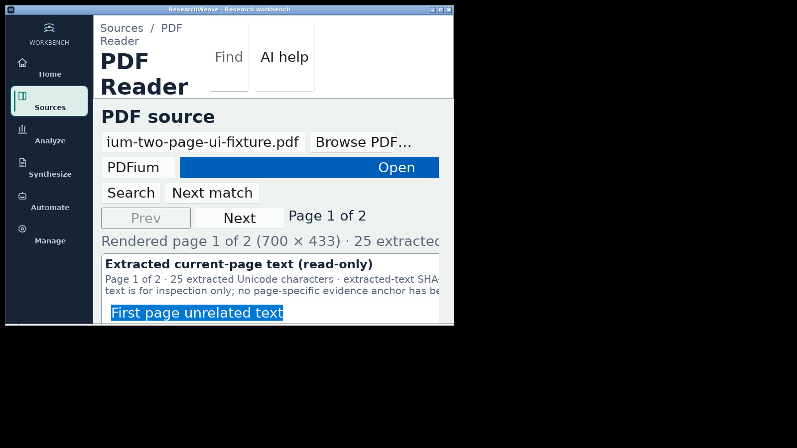
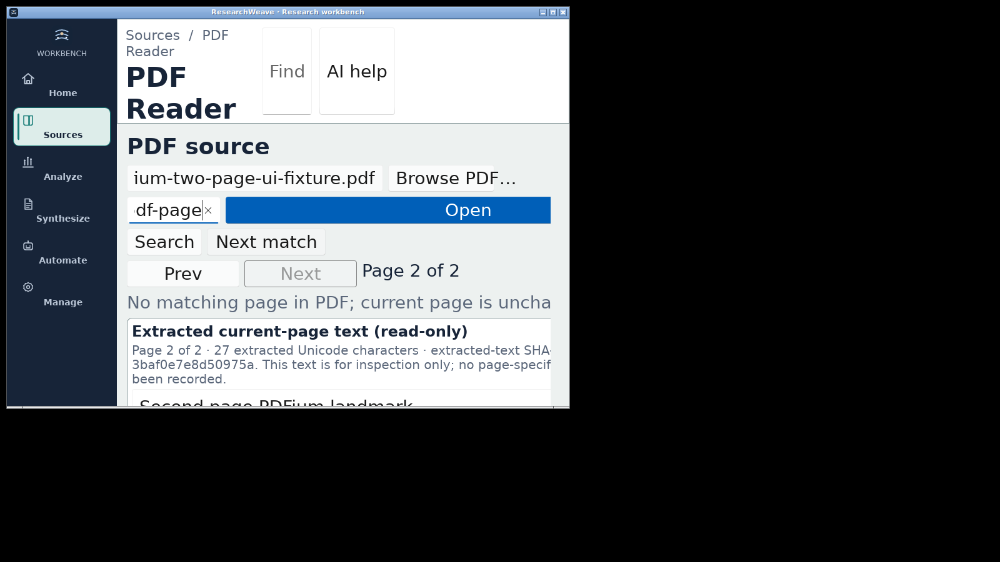

# Native GUI acceptance: Notes context and narrow PDF Reader

**Observed:** 30 October 2026. **Source:** `8015a2c19dc0872bfa457aa6e2c262f883f132c1` on `ux/researchweave-20261029`. Both checks exercised the actual optimized Linux Rust/Slint executable in a private Xvfb/Openbox/D-Bus session and a disposable local project profile. No user's active Windows desktop, stored project or network model was used.

## Reproducible source and executable

- **Optimized Linux executable SHA-256:** `01b2edd15df91080e1f86f604dc475643c710e1528be9a21796c9158cb939745`
- **`crates/researchweave-desktop/src/main.rs` SHA-256:** `e66e594b3377fffff92efdcce24286fa169e054704492d0d571e7c49709a6b6f`
- **`crates/researchweave-desktop/ui/main.slint` SHA-256:** `3d656c1f64b3b178c22b447eaf379fb4b7f2ba2bd8b38c72ff23442eb1cb0d07`
- **Exact Linux PDF fixture SHA-256:** `c0f54e821f5ffcc06eb10ae4a165881251cd5cd5bb397d3fc101a33fe672fa52`
- Build command in a frozen source checkout: `cargo build --locked --release -p researchweave-desktop`. Native PDFium was staged alongside the executable. Actual UI commands and assertions are in `scripts/ux/isolated-xvfb-notes-context-ai.sh` and `scripts/ux/isolated-xvfb-pdf-narrow-200.sh`. Each script requires a **new** evidence path.

## Observed GUI results

| Scenario | Result and direct assertion |
| --- | --- |
| Saved Research Notebook Markdown | **PASS.** A read-only native editor exposed Markdown with `# Research notebook`, `*Saved revision` and the exact synthetic body. Direct SQLite query found revision 1 and the identical body. See `research-notebook-export.json`. |
| Research Notebook AI preview | **PASS.** Preview contained the visible research notebook body and excluded a selected but hidden Quick Note body. No model had been configured; inference dispatch remained disabled. |
| Quick Note AI preview | **PASS.** After switching views, preview contained the selected Quick Note body and excluded the hidden research notebook body. |
| Actual 200% interface scale | **PASS.** Increased scale via Preferences, confirmed persisted setting, used a **900 × 620** native window. |
| PDF pages 1 and 2 | **PASS.** Opened a two-page synthetic PDF, verified native page controls, exact Unicode text clipboard, disabled editing, and page-specific contents. |
| Search with no matching PDF page | **PASS.** Native Find Next reported no match, preserved page 2 and retained exact extracted page text. The read-only extraction was compared with the fixture. See `no-hit.json`. |
| Change PDF path | **PASS.** Invalidated previously extracted text and page state; the old text did not remain accessible after the path change. |

The complete original disposable receipts also contain script/binary/source checksums before and after, native log output, accessibility JSON, and further screenshots. The source and executable hashes above were matched before running. Screenshot/JSON hashes in `SHA256SUMS.txt` allow verification of these portable copies.

## Hosted package evidence and limitations

The matching **source commit** passed [native release-candidate workflow 41067262835](https://github.com/aradmanamnaoon/researchweave/actions/runs/41067262835): security, Windows installed UI Automation, Ubuntu DEB/AppImage native checks, macOS ARM64, macOS Intel, and `verify-complete` for all five candidate packages. Two Rust quality workflows for that SHA passed as well. Artifacts remain workflow downloads, **not** a new published release.

These tests establish specific observable behaviors, **not** completion of the entire product. The [100-skill source audit](../../100_SKILLS_APPLICATION_MATRIX.md) found 100 source witnesses but did not issue 100 independent real-GUI signoffs. Human accessibility/VoiceOver/Orca, long-form structured Word-style editing, persistent PDF annotations and verified PDF quote/source anchors, comprehensive 109-scenario acceptance, and post-release anonymous download verification are not established by this evidence. PR #16 is still draft; public v0.2.0 remains unchanged.
